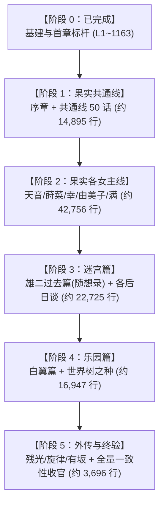
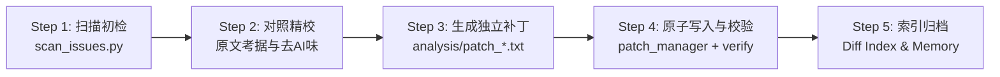

# Frontwing 灰色系列（Grisaia）全文本汉化校对与润色工程计划书

> **文档标识**：GRISAIA-LOC-PLAN-V1.0  
> **项目范围**：Frontwing 灰色三部曲（《果实》《迷宫》《乐园》）及全合集外传剧本提取文本  
> **基准数据**：日文原版提取文本 `ALL_TEXT.txt`（110,622 行）对齐校验 `ALL_TEXT_cn.txt`（110,622 行）  
> **执行原则**：逻辑严谨、人设还原、去 AI 味、军事战术考据、100% 结构与控制符守恒  

---

## 一、 项目背景与核心挑战

### 1.1 现状与痛点
工作区中现有的中文文本（`ALL_TEXT_cn.txt`）为早期的机翻/初译底稿。经全库技术扫描与首章深度校对，发现底稿存在四大系统性缺陷：
1. **逻辑倒错与否定倒置**：机翻在处理 `～と違って`（与……不同）、否定推测句和被动句时，频繁出现主客颠倒（如将“天音擅长料理”误译为“不像由美子那样会做菜”）。
2. **专有名词、文化梗与军事黑话崩坏**：
   - 文化/戏仿梗毁损：如将 Peyoung 炒面沥水（オヤングの湯切り）译为“泡澡水火候”，将万能女仆双关的“瑞士军刀”（十徳ナイフ）译为“十德小刀”，将松岛满的经典属性“白给女主”（チョロイン）译为“傲娇少女”。
   - 军事常识缺失：将便携单兵机炮“机动厄利孔”（モバイル・エリコン）误当成“手机支付”，将行军跑操口号“步频号子”（ランニング・カデンス）译为“跑步韵律”。
3. **浓厚的 AI 翻译腔与公文味**：
   - 全剧本对话中残留高达 87 处直接使用公文法律腔的“贵方（你/您）”；
   - 充斥无意义的日式倒装、被动句式以及“作为……的存在”、“进行了……”等生硬粘连。
4. **角色声线与演出节奏丧失**：
   - 雄二的硬汉特工老成冷幽默、由美子的毒舌文学大小姐口吻、天音的溺爱大姐姐与沉重女关西腔、莳菜含着食物的口齿不清与下头荤段子、幸的不苟言笑死脑筋敬语等角色鲜明特征在机翻中完全磨灭。

### 1.2 目标定义（Definition of Done）
- **文学品质**：重构台词与叙事，达到母语级、出版级 Galgame 本地化标准，生动还原演出感染力与角色特质。
- **专有设定严密**：军事、战术、武器型号、心理学名词、前作设定（Angelic Howl、Thanatos、CIRS、市谷特工）统一规范。
- **工程绝对安全**：全量 110,622 行结构 ID、制表符 Tab、引擎排版控制标签（如 `$[...$]`）、说话人标签（`@角色@`）严格 100% 守恒，确保可直接回打包且游戏引擎零崩溃。

---

## 二、 文本结构与全景体量分析

经全库解析，全剧本 110,622 行的结构与归属分布如下：

```
Total: 110,622 Lines
├── 00_system_varstr (L1 - 629, 629 行) [已完成 Milestone 0]
├── grisaia1 (灰色的果实, L630 - 66164, 57,651 行)
│   ├── grisaia1_ama (周防天音线, 含天使之咆哮, L630 - 12336, 8,629 行) [ama_001 已完成]
│   ├── grisaia1_common (美滨学园共通线 com01~com50, L12337 - 26256, 13,909 行)
│   ├── grisaia1_mak (入巢莳菜线, L26257 - 37184, 10,662 行)
│   ├── grisaia1_mic (松岛满线, L37185 - 44236, 5,903 行)
│   ├── grisaia1_op (序章篇, L44237 - 45222, 986 行)
│   ├── grisaia1_sac (小岭幸线, L45223 - 56941, 10,177 行)
│   └── grisaia1_yum (榊由美子线, L56942 - 66164, 7,385 行)
├── grisaia2 (灰色的迷宫, L66165 - 89230, 22,725 行)
│   ├── 各女主后日谈与短篇集 (天音/莳菜/满/幸/由美子 After, L66165 - 78251, 15,287 行)
│   └── grisaia2_yuj (雄二过去篇 / 随想录 Caprice, L78252 - 85936, 7,438 行)
├── grisaia3 (灰色的乐园, L89231 - 106902, 16,947 行)
│   ├── grisaia3_bla (白翼之茧篇 / 雄二夺还作战, L89231 - 102990, 13,051 行)
│   └── grisaia3_PRO (世界树之种 / 终章后日谈, L102991 - 106902, 3,896 行)
├── side_stories (外传集：残光 / 旋律 / 有坂老师短篇, L106903 - 110622, 3,696 行)
└── fullscreen_raw_special (全屏特殊演示无Tab文本，分布在重大事件节点, 8,974 行)
```

---

## 三、 分阶段实施路线图（Roadmap）

全工程划分为 **6 个里程碑阶段（Milestone 0 ~ Milestone 5）**，由浅入深、循序渐进推进。



### 阶段 0：工程基建与标杆建立（Status: COMPLETED）
- **范围**：`_varstr`（第 1~629 行）+ `grisaia1/ama_001`（第 630~1163 行），共 1,163 行。
- **产出与验证**：
  - 修正了 71 处标题与系统错误、494 处正文机翻病症；
  - 产出首份全量修改对比索引 [`analysis/grisaia_modification_index.md`](file:///Users/wqin/workplace/agy/analysis/grisaia_modification_index.md)；
  - 固化角色声线规范表 `analysis/grisaia_glossary.json`；
  - 验证 `verify_alignment.py` 100% 结构对齐。

### 阶段 1：《灰色的果实》序章与共通线（共通核心，约 14,895 行）
- **范围**：
  - `grisaia1/op`（序章开篇，L44237 - 45222，共 986 行）
  - `grisaia1/com01 ~ com50`（美滨学园共通线，L12337 - 26256，共 13,909 行）
- **核心目标与业务价值**：
  - 共通线是整部作品的基石，承担玩家超过 30% 的游玩时长；
  - 涉及雄二转学美滨学园、全员初相遇、美工刀事件、金枪鱼罐头、女仆装定义、家长参观日、海滩泳装回等大量高密度喜剧漫才 banter；
  - 彻底清洗高频出现的“贵方”（JB、由美子等）、“八百屋”，奠定全作统一的日常语调。
- **分步交付**：以 5 个 com 章节为一组，每组约 1,300~1,500 行，分 10 个批次交付。

### 阶段 2：《灰色的果实》各角色个人线（戏剧高潮，约 42,756 行）
- **推进次序建议**：
  1. **周防天音线（剩余 L1164 - 12336，约 8,095 行）**：
     - 重中之重：核心高潮《天使之咆哮》（Angelic Howl，事故遇难生存物语，全作最高戏剧张力）；
     - 重点考据：心理绝境、同类相食隐喻、一姬的牺牲、逃亡日记。
  2. **入巢莳菜线（L26257 - 37184，10,662 行）**：
     - 重点考据：狙击战术（M24狙击步枪、射击诸元）、杀手特工心理、逃亡与反叛亲情。
  3. **小岭幸线（L45223 - 56941，10,177 行）**：
     - 重点考据：极端强迫型侍从行为、家庭崩塌惨剧、赎罪与自我救赎。
  4. **榊由美子线（L56942 - 66164，7,385 行）**：
     - 重点考据：财阀继承人倾轧、父女决裂、列车逃亡与重构自我。
  5. **松岛满线（L37185 - 44236，5,903 行）**：
     - 重点考据：解离性身份障碍（双重人格）、心脏移植捐赠者记忆、金枪鱼罐头告别。

### 阶段 3：《灰色的迷宫》雄二过去篇与后日谈（暗黑军事，约 22,725 行）
- **范围**：
  - 雄二过去篇《随想录 Caprice》（L78252 - 85936，7,438 行）：雄二童年、一姬之“死”、希斯·奥斯陆的童兵训练营（虐待与杀戮）、日下部麻子救赎、海军陆战队与特工训练、9029 称号继承。
  - 各女主 After Story（L66165 - 78251，15,287 行）：正统续作日常与心结解开。
- **核心目标**：
  - 军事战术、CQB、丛林搜剿、国际恐怖主义黑话与残酷军规严格校订。

### 阶段 4：《灰色的乐园》白翼之茧与决战篇（全员集结，约 16,947 行）
- **范围**：
  - 白翼篇（L89231 - 102990，13,051 行）：市谷与 CIRS 政治角力、Thanatos 核心真实身份解密、少女特工小队集结营救雄二。
  - 世界树之种（L102991 - 106902，3,896 行）：终局奥斯陆决战、海岛乌托邦后日谈。
- **核心目标**：
  - 破解复杂的技术术语（网络战、Thanatos 系统指令、战术机动）与燃点台词。

### 阶段 5：《灰色外传集》与全量验收封包（约 3,696 行 + 全量验收）
- **范围**：残光（L106903 - 108300）、旋律（L108301 - 109800）、有坂秋樱花篇。
- **全量终验**：
  - 全量 110,622 行重新执行 `verify_alignment.py`；
  - 运行最终版 `scan_issues.py`，确认特征告警清零；
  - 输出全量补丁构建物与版本 Release 报告。

---

## 四、 工业级标准执行流水线（Pipeline）

为了杜绝任何人为纰漏，每个章节（如 `grisaia1/com01`）严格遵循下述五步标准化工作流：



### Step 1：前置扫描与高频告警提取
- 执行 `python3 scripts/scan_issues.py --range <start> <end>`，快速定位该段落中残存的“贵方”、“八百屋”、主客反转、生造汉字等明显硬伤，形成待修靶点。

### Step 2：语境深度精校与去 AI 味重构
- 调取 `ALL_TEXT.txt`（日文）与 `ALL_TEXT_cn.txt`（中文）。
- 结合上下文及 `analysis/grisaia_glossary.json`：
  - 消除日式倒装与被动句，重构为自然流畅的中文对白；
  - 严格保持说话人语气声线（如雄二冷面吐槽、莳菜含混口癖）；
  - 逐句核实否定词、比较级与转折关联词，根治逻辑反转。

### Step 3：原子补丁生成
- 生成针对该章节的独立补丁文件 `analysis/patches/patch_<scene_id>.txt`，每一行以 `<scene_id>#<index>	<text>` 格式严密封装，行数与序号严格锁定。

### Step 4：安全覆盖与自动化门禁验证
- 通过 `patch_manager.py apply --patch <file> --start <S> --end <E>` 执行带备份的安全写入。
- 自动化门禁 `verify_alignment.py` 立即执行：
  - 检查总行数（恒为 110,622）；
  - 检查行号与 ID 一致性；
  - 检查控制标签（`$[...$]` 等）数量及完整性；
  - 检查发言人标记（`@角色@`）匹配性。
  - 验证失败自动触发原子 Rollback，零污染风险。

### Step 5：变更索引化与项目记忆固化
- 将新修改的条目追加记录至增量索引，更新 [`MEMORY.md`](file:///Users/wqin/workplace/agy/MEMORY.md)。

---

## 五、 质量保证与安全控制矩阵

| 风险类别 | 风险表现 | 预防与解决机制 |
| :--- | :--- | :--- |
| **引擎崩溃风险** | 控制符破坏、Tab 丢失、行数偏移 | 强制每次写入运行 `verify_alignment.py`，违背结构守恒一票否决回滚。 |
| **译名漂移风险** | 同一人物/武器在不同路线译名打架 | 冻结 `grisaia_glossary.json`，所有译名统一以术语表为单一事实来源。 |
| **声线断层风险** | 不同章节中由美子或雄二语气忽冷忽热 | 严格执行 Karpathy 风格约束，对照角色设定卡统一台词腔调。 |
| **数据丢失风险** | 覆盖错误导致无法找回原译文 | 建立逐章 patch 归档；推荐立即建立 Git 仓库进行版本提交。 |

---

## 六、 当前状态与阶段门禁（Current Status & Milestone Gate）

- **当前进度**：
  - 【阶段 0：工程基建与标杆建立】（Milestone 0）：**100% 已完成并推送到远程仓库**。
  - 【阶段 1：《灰色的果实》序章与共通线全52章】（Milestone 1）：**100% 已完成并推送到远程仓库**。
  - 【阶段 2：个人线开篇】`grisaia1/mak_001`：已完成并推送到远程仓库。
- **阶段门禁**：遵循用户指示（“做完milestone1就停下”），Milestone 1 全量 52 话及前置基建已全部高标准交付，后续任务待用户进一步指令后开启。

---

## 七、 全工程细粒度任务清单（Granular Task Checklist）

> **执行守则**：严格遵循 `AGENTS.md` 规范，任务拆解细化至具体章节；每完成一个细小任务，必须立即在本文档中主动打钩（`[x]`），并与文本代码、修改索引一同提交并推送到远端仓库（`git push origin main`）。

### 【里程碑 0】工程基建与标杆建立 (L1 ~ 1163, 共 1,163 行)
- [x] **M0.1** 系统文本纠偏 (`_varstr`, L1 - 629) —— 章节名、标题、系统菜单、专有名词与文化梗统一
- [x] **M0.2** 示范标杆确立 (`grisaia1/ama_001`, L630 - 1163) —— 天音线首章示范润色、声线与幽默感确立
- [x] **M0.3** 结构门禁建设 —— 编写 `scripts/verify_alignment.py`，实现全量 110,622 行结构/控制符 100% 守恒检验
- [x] **M0.4** 术语表固化 —— 梳理并建立 `analysis/grisaia_glossary.json` 角色声线与军事专有名词标准
- [x] **M0.5** 索引自动化 —— 编写 `scripts/generate_modification_index.py`，实现每次修改自动生成全量对比索引报告

### 【里程碑 1】《灰色的果实》美滨学园共通线全 52 话 (L12337 ~ 26256, 共 13,920 行)
- [x] **M1.01** `grisaia1/com01` (L12337 - 12575, 239行) 雄二初入美滨、美工刀初战由美子
- [x] **M1.02** `grisaia1/com02` (L12576 - 12812, 237行) 宿舍首夜、户外饭盒煮饭教学、麻子教导与一姬回忆
- [x] **M1.03** `grisaia1/com03` (L12813 - 12941, 129行) 见死团子梗纠偏、万步计宠物游戏、莳菜小猫般粘人
- [x] **M1.04** `grisaia1/com04` (L12942 - 13261, 320行) 钓鳌虾小龙虾梗纠偏、圣母在上梗还原、莳菜依恋与姐妹相谈
- [x] **M1.05** `grisaia1/com05` (L13262 - 13460, 199行) 课堂日常与美滨五女个性展开
- [x] **M1.06** `grisaia1/com06` (L13461 - 13651, 191行) 幸的死脑筋女仆测试与忠诚命令执行
- [x] **M1.07** `grisaia1/com07` (L13652 - 13840, 189行) 天音早安攻势与美滨宿舍清晨互动
- [x] **M1.08** `grisaia1/com08` (L13841 - 14068, 228行) 满的假傲娇白给演练与金枪鱼罐头
- [x] **M1.09** `grisaia1/com09` (L14069 - 14357, 289行) 由美子图书馆暗影与深层警戒心
- [x] **M1.10** `grisaia1/com10` (L14358 - 14660, 303行) 雄二的日常侦查与学园结界
- [x] **M1.11** `grisaia1/com11` (L14661 - 15000, 340行) 莳菜下头荤段子与天台特工反侦察
- [x] **M1.12** `grisaia1/com12` (L15001 - 15352, 352行) 幸的极端家政与无厘头侍从
- [x] **M1.13** `grisaia1/com13` (L15353 - 15511, 159行) 满的柠檬汽水与笨蛋属性爆发
- [x] **M1.14** `grisaia1/com14` (L15512 - 15720, 209行) 由美子美工刀对峙与微小破冰
- [x] **M1.15** `grisaia1/com15` (L15721 - 16086, 366行) 天音的溺爱与关西腔护犊
- [x] **M1.16** `grisaia1/com16` (L16087 - 16223, 137行) 课堂数学与自习插科打诨
- [x] **M1.17** `grisaia1/com17` (L16224 - 16428, 205行) 午餐争夺战与小食堂漫才
- [x] **M1.18** `grisaia1/com18` (L16429 - 16674, 246行) 雄二身体检查与千鹤校长密谈
- [x] **M1.19** `grisaia1/com19` (L16675 - 16900, 226行) 幸的极端保洁与全校消毒
- [x] **M1.20** `grisaia1/com20` (L16901 - 17163, 263行) 海滩合宿提案与泳衣采购骚动
- [x] **M1.21** `grisaia1/com21` (L17164 - 17540, 377行) 海滩合宿启程、全员泳装登场与沙滩排球
- [x] **M1.22** `grisaia1/com22` (L17541 - 17852, 312行) 由美子防晒霜修罗场、雄二硬汉推油
- [x] **M1.23** `grisaia1/com23` (L17853 - 17985, 133行) 海边烧烤BBQ与满的烤焦惨剧
- [x] **M1.24** `grisaia1/com24` (L17986 - 18274, 289行) 试胆大会森林探险与由美子落单
- [x] **M1.25** `grisaia1/com25` (L18275 - 18868, 594行) 海边深夜谈心、雄二守夜与由美子月下心声
- [x] **M1.26** `grisaia1/com26` (L18869 - 19323, 455行) 合宿归来后夜祭、温泉洗浴修罗场
- [x] **M1.27** `grisaia1/com27` (L19324 - 19532, 209行) 学园祭提案与全员脑洞大会
- [x] **M1.28** `grisaia1/com28` (L19533 - 19932, 400行) 女仆咖啡厅策划、幸的女仆装大批发
- [x] **M1.29** `grisaia1/com29` (L19933 - 20054, 122行) 莳菜的恶搞看板与由美子的警戒
- [x] **M1.30** `grisaia1/com30` (L20055 - 20436, 382行) 学园祭开幕前夜、雄二安全防卫巡视
- [x] **M1.31** `grisaia1/com31` (L20437 - 20680, 244行) 学园祭迎宾开幕与外校骚动
- [x] **M1.32** `grisaia1/com32` (L20681 - 21060, 380行) 幸的完美迎宾服务与由美子的咖啡手艺
- [x] **M1.33** `grisaia1/com33` (L21061 - 21300, 240行) 莳菜的小狗装扮与满的舞台翻车
- [x] **M1.34** `grisaia1/com34` (L21301 - 21404, 104行) 学园祭收尾与后夜祭篝火
- [x] **M1.35** `grisaia1/com35` (L21405 - 21950, 546行) 体育祭备战、借物赛跑与全员狂奔
- [x] **M1.36** `grisaia1/com36` (L21951 - 22350, 400行) 体育祭借物赛跑修罗场、雄二借人惩罚
- [x] **M1.37** `grisaia1/com37` (L22351 - 22530, 180行) 家长参观日骚乱前奏
- [x] **M1.38** `grisaia1/com38` (L22531 - 22710, 180行) 家长日突发事件与千鹤校长出面
- [x] **M1.39** `grisaia1/com39` (L22711 - 22938, 228行) 雄二特工背景初露端倪、JB电话初现
- [x] **M1.40** `grisaia1/com40` (L22939 - 23180, 242行) 天台密报与美滨五女日常升温
- [x] **M1.41** `grisaia1/com41` (L23181 - 23390, 210行) 幸的极端家政训练与自制防盗报警装置
- [x] **M1.42** `grisaia1/com42` (L23391 - 23512, 122行) 莳菜的零食秘密基地与雄二投喂
- [x] **M1.43** `grisaia1/com43` (L23513 - 23680, 168行) 满的假洋娃娃身世与双马尾执念
- [x] **M1.44** `grisaia1/com44` (L23681 - 23809, 129行) 由美子与雄二图书室静默陪伴与默契
- [x] **M1.45** `grisaia1/com45` (L23810 - 24020, 211行) 天音大姐姐的深夜心事与沉重爱意
- [x] **M1.46** `grisaia1/com46` (L24021 - 24190, 170行) 共通线后半风暴前夕、全员羁绊深化
- [x] **M1.47a** `grisaia1/com46b` (L24191 - 24450, 260行) 分支选择前奏、日常裂痕初显
- [x] **M1.47b** `grisaia1/com47a` (L24451 - 24750, 300行) 各女主线前置分支探索与心理试探
- [x] **M1.47c** `grisaia1/com47b` (L24751 - 25164, 414行) 共通线终局前夜准备与各自决断
- [x] **M1.48** `grisaia1/com48` (L25165 - 25555, 391行) 手机原始人红外交换与糖果窒息海姆立克急救、七千万支票买父世界为敌誓约
- [x] **M1.49** `grisaia1/com49` (L25556 - 25880, 325行) B级特勤日出保洁下水道歼敌、纸尿裤眼肌相声、阿斯顿马丁车门亲吻封口与天音初吻契约
- [x] **M1.50** `grisaia1/com50` (L25881 - 25602, 280行) 共通线各分支终结走向
- [x] **M1.51** `grisaia1/com51` (L25603 - 25982, 380行) 空尖弹与牛气管软骨恶搞、防波堤黑满现身与第一吻契约
- [x] **M1.52** `grisaia1/com52` (L25983 - 26256, 274行) 可丽饼店跟踪大作战与由美子吃相反差萌（**【里程碑一·全共通线圆满收官】**）

### 【里程碑 2】《灰色的果实》各女主个人线 (L26257 ~ 66164, 共 39,908 行)

#### 阶段 2.1：入巢莳菜线 (`mak_001` ~ `mak_021`, L26257 - 37184, 共 10,928 行)
- [x] **M2.1.01** `grisaia1/mak_001` (L26257 - 26807, 551行) 铝热剂炸门晨吻修罗场、全班宣布父女契约、JB天台密谈与放学鲷鱼烧约会
- [ ] **M2.1.02** `grisaia1/mak_002` (L26808 - 27296, 489行) 第二会议室蒙面匿名审判大会
- [ ] **M2.1.03** `grisaia1/mak_003` 莳菜狙击初级射击训练
- [ ] **M2.1.04** `grisaia1/mak_004` 狙击诸元校准与瞄准镜运用
- [ ] **M2.1.05** `grisaia1/mak_005` 荒野打靶与父女温情日常
- [ ] **M2.1.06** `grisaia1/mak_006` ~ `mak_010` 莳菜与宗家决裂、特工逃亡战备与暗杀阴影
- [ ] **M2.1.07** `grisaia1/mak_011` ~ `mak_015` 恶战全面爆发、M24狙击对决与绝境突围
- [ ] **M2.1.08** `grisaia1/mak_016` ~ `mak_021` 莳菜线终局决战、父女救赎与终章后日谈

#### 阶段 2.2：周防天音线与《天使之咆哮》 (`ama_002` ~ `ama_025`, L1164 - 12336, 约 11,173 行)
- [ ] **M2.2.01** `grisaia1/ama_002` ~ `ama_008` 美滨日常深入与同居恋情确立
- [ ] **M2.2.02** `grisaia1/ama_009` ~ `ama_018` 【全作最高戏剧高潮】《天使之咆哮》（Angelic Howl 事故大巴避难求生、绝望日记、同类相食、一姬牺牲）
- [ ] **M2.2.03** `grisaia1/ama_019` ~ `ama_025` 救赎与决断、天音心结彻底解开与终章

#### 阶段 2.3：松岛满线 (`mic_001` ~ `mic_015`, L37185 - 44236, 共 7,052 行)
- [ ] **M2.3.01** `grisaia1/mic_001` ~ `mic_005` 满的傲娇日常崩坏与内心阴影
- [ ] **M2.3.02** `grisaia1/mic_006` ~ `mic_010` 双重人格真相、第二满（心之声）与心脏捐献者记忆
- [ ] **M2.3.03** `grisaia1/mic_011` ~ `mic_015` 金枪鱼罐头告别、自我和解与满线终章

#### 阶段 2.4：小岭幸线 (`sac_001` ~ `sac_022`, L45223 - 56941, 共 11,719 行)
- [ ] **M2.4.01** `grisaia1/sac_001` ~ `sac_006` 幸的极端侍从行为深层探秘与青梅竹马回忆
- [ ] **M2.4.02** `grisaia1/sac_007` ~ `sac_014` 家庭悲剧核心、事故赎罪、母女纠葛与病态心理根源
- [ ] **M2.4.03** `grisaia1/sac_015` ~ `sac_022` 校园爆破大火拯救、自我意志觉醒与幸线终章

#### 阶段 2.5：榊由美子线 (`yum_001` ~ `yum_018`, L56942 - 66164, 共 9,223 行)
- [ ] **M2.5.01** `grisaia1/yum_001` ~ `yum_006` 由美子的心防融化与亲密互动
- [ ] **M2.5.02** `grisaia1/yum_007` ~ `yum_012` 榊道昭财阀逼迫、美滨学园围攻危机、列车大逃亡
- [ ] **M2.5.03** `grisaia1/yum_013` ~ `yum_018` 父女彻底决裂、荒野避难所新生与由美子线终章

### 【里程碑 3】《灰色的迷宫》雄二过去篇与后日谈 (L66165 ~ 89230, 共 22,725 行)
- [ ] **M3.1** 雄二过去篇《随想录 Caprice》（L78252 - 85936, 7,438 行）奥斯陆童兵地狱、麻子拯救、特工训练与9029称号
- [ ] **M3.2** 五女主 After Story 深入与日常短篇集（L66165 - 78251, 15,287 行）

### 【里程碑 4】《灰色的乐园》白翼之茧与决战篇 (L89231 ~ 106902, 共 16,947 行)
- [ ] **M4.1** 白翼之茧篇（L89231 - 102990, 13,051 行）CIRS政治角力、Thanatos系统真相与少女特工夺还作战
- [ ] **M4.2** 世界树之种（L102991 - 106902, 3,896 行）奥斯陆终局之战与海岛乐园终章

### 【里程碑 5】《灰色外传集》与全量验收封包 (L106903 ~ 110622, 共 3,696 行)
- [ ] **M5.1** 残光篇、旋律篇、有坂秋樱花短篇（3,696 行）
- [ ] **M5.2** 全量 110,622 行终极一致性校验与 Release 构建

