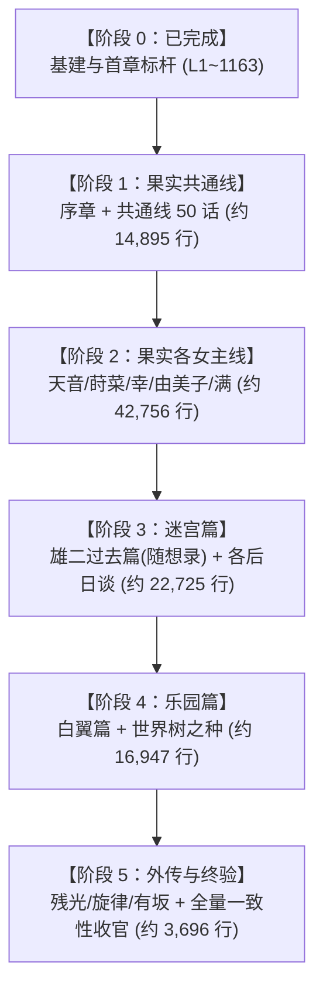
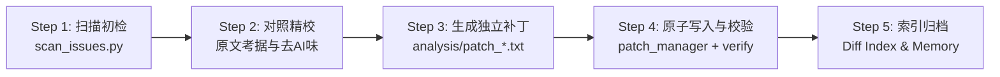

# Frontwing 灰色系列（Grisaia）全文本汉化校对与润色工程计划书

> **文档标识**：GRISAIA-LOC-PLAN-V1.0  
> **项目范围**：Frontwing 灰色三部曲（《果实》《迷宫》《乐园》）及全合集外传剧本提取文本  
> **基准数据**：日文原版提取文本 `ALL_TEXT.txt`（110,622 行）对齐校验 `ALL_TEXT_cn.txt`（110,622 行）  
> **执行原则**：逻辑严谨、人设还原、去 AI 味、军事战术考据、100% 结构与控制符守恒  

---

## 一、 项目背景与核心挑战

### 1.1 现状与痛点
工作区中现有的中文文本（`ALL_TEXT_cn.txt`）为早期的机翻/初译底稿。经全库技术扫描与首章深度校对，发现底稿存在四大系统性缺陷：
1. **逻辑倒错与否定倒置**：机翻在处理 `～と違って`（与……不同）、否定推测句和被动句时，频繁出现主客颠倒（如将“天音擅长料理”误译为“不像由美子那样会做菜”）。
2. **专有名词、文化梗与军事黑话崩坏**：
   - 文化/戏仿梗毁损：如将 Peyoung 炒面沥水（オヤングの湯切り）译为“泡澡水火候”，将万能女仆双关的“瑞士军刀”（十徳ナイフ）译为“十德小刀”，将松岛满的经典属性“白给女主”（チョロイン）译为“傲娇少女”。
   - 军事常识缺失：将便携单兵机炮“机动厄利孔”（モバイル・エリコン）误当成“手机支付”，将行军跑操口号“步频号子”（ランニング・カデンス）译为“跑步韵律”。
3. **浓厚的 AI 翻译腔与公文味**：
   - 全剧本对话中残留高达 87 处直接使用公文法律腔的“贵方（你/您）”；
   - 充斥无意义的日式倒装、被动句式以及“作为……的存在”、“进行了……”等生硬粘连。
4. **角色声线与演出节奏丧失**：
   - 雄二的硬汉特工老成冷幽默、由美子的毒舌文学大小姐口吻、天音的溺爱大姐姐与沉重女关西腔、莳菜含着食物的口齿不清与下头荤段子、幸的不苟言笑死脑筋敬语等角色鲜明特征在机翻中完全磨灭。

### 1.2 目标定义（Definition of Done）
- **文学品质**：重构台词与叙事，达到母语级、出版级 Galgame 本地化标准，生动还原演出感染力与角色特质。
- **专有设定严密**：军事、战术、武器型号、心理学名词、前作设定（Angelic Howl、Thanatos、CIRS、市谷特工）统一规范。
- **工程绝对安全**：全量 110,622 行结构 ID、制表符 Tab、引擎排版控制标签（如 `$[...$]`）、说话人标签（`@角色@`）严格 100% 守恒，确保可直接回打包且游戏引擎零崩溃。

---

## 二、 文本结构与全景体量分析

经全库解析，全剧本 110,622 行的结构与归属分布如下：

```
Total: 110,622 Lines
├── 00_system_varstr (L1 - 629, 629 行) [已完成 Milestone 0]
├── grisaia1 (灰色的果实, L630 - 66164, 57,651 行)
│   ├── grisaia1_ama (周防天音线, 含天使之咆哮, L630 - 12336, 8,629 行) [ama_001 已完成]
│   ├── grisaia1_common (美滨学园共通线 com01~com50, L12337 - 26256, 13,909 行)
│   ├── grisaia1_mak (入巢莳菜线, L26257 - 37184, 10,662 行)
│   ├── grisaia1_mic (松岛满线, L37185 - 44236, 5,903 行)
│   ├── grisaia1_op (序章篇, L44237 - 45222, 986 行)
│   ├── grisaia1_sac (小岭幸线, L45223 - 56941, 10,177 行)
│   └── grisaia1_yum (榊由美子线, L56942 - 66164, 7,385 行)
├── grisaia2 (灰色的迷宫, L66165 - 89230, 22,725 行)
│   ├── 各女主后日谈与短篇集 (天音/莳菜/满/幸/由美子 After, L66165 - 78251, 15,287 行)
│   └── grisaia2_yuj (雄二过去篇 / 随想录 Caprice, L78252 - 85936, 7,438 行)
├── grisaia3 (灰色的乐园, L89231 - 106902, 16,947 行)
│   ├── grisaia3_bla (白翼之茧篇 / 雄二夺还作战, L89231 - 102990, 13,051 行)
│   └── grisaia3_PRO (世界树之种 / 终章后日谈, L102991 - 106902, 3,896 行)
├── side_stories (外传集：残光 / 旋律 / 有坂老师短篇, L106903 - 110622, 3,696 行)
└── fullscreen_raw_special (全屏特殊演示无Tab文本，分布在重大事件节点, 8,974 行)
```

---

## 三、 分阶段实施路线图（Roadmap）

全工程划分为 **6 个里程碑阶段（Milestone 0 ~ Milestone 5）**，由浅入深、循序渐进推进。



### 阶段 0：工程基建与标杆建立（Status: COMPLETED）
- **范围**：`_varstr`（第 1~629 行）+ `grisaia1/ama_001`（第 630~1163 行），共 1,163 行。
- **产出与验证**：
  - 修正了 71 处标题与系统错误、494 处正文机翻病症；
  - 产出首份全量修改对比索引 [`analysis/grisaia_modification_index.md`](file:///Users/wqin/workplace/agy/analysis/grisaia_modification_index.md)；
  - 固化角色声线规范表 `analysis/grisaia_glossary.json`；
  - 验证 `verify_alignment.py` 100% 结构对齐。

### 阶段 1：《灰色的果实》序章与共通线（共通核心，约 14,895 行）
- **范围**：
  - `grisaia1/op`（序章开篇，L44237 - 45222，共 986 行）
  - `grisaia1/com01 ~ com50`（美滨学园共通线，L12337 - 26256，共 13,909 行）
- **核心目标与业务价值**：
  - 共通线是整部作品的基石，承担玩家超过 30% 的游玩时长；
  - 涉及雄二转学美滨学园、全员初相遇、美工刀事件、金枪鱼罐头、女仆装定义、家长参观日、海滩泳装回等大量高密度喜剧漫才 banter；
  - 彻底清洗高频出现的“贵方”（JB、由美子等）、“八百屋”，奠定全作统一的日常语调。
- **分步交付**：以 5 个 com 章节为一组，每组约 1,300~1,500 行，分 10 个批次交付。

### 阶段 2：《灰色的果实》各角色个人线（戏剧高潮，约 42,756 行）
- **推进次序建议**：
  1. **周防天音线（剩余 L1164 - 12336，约 8,095 行）**：
     - 重中之重：核心高潮《天使之咆哮》（Angelic Howl，事故遇难生存物语，全作最高戏剧张力）；
     - 重点考据：心理绝境、同类相食隐喻、一姬的牺牲、逃亡日记。
  2. **入巢莳菜线（L26257 - 37184，10,662 行）**：
     - 重点考据：狙击战术（M24狙击步枪、射击诸元）、杀手特工心理、逃亡与反叛亲情。
  3. **小岭幸线（L45223 - 56941，10,177 行）**：
     - 重点考据：极端强迫型侍从行为、家庭崩塌惨剧、赎罪与自我救赎。
  4. **榊由美子线（L56942 - 66164，7,385 行）**：
     - 重点考据：财阀继承人倾轧、父女决裂、列车逃亡与重构自我。
  5. **松岛满线（L37185 - 44236，5,903 行）**：
     - 重点考据：解离性身份障碍（双重人格）、心脏移植捐赠者记忆、金枪鱼罐头告别。

### 阶段 3：《灰色的迷宫》雄二过去篇与后日谈（暗黑军事，约 22,725 行）
- **范围**：
  - 雄二过去篇《随想录 Caprice》（L78252 - 85936，7,438 行）：雄二童年、一姬之“死”、希斯·奥斯陆的童兵训练营（虐待与杀戮）、日下部麻子救赎、海军陆战队与特工训练、9029 称号继承。
  - 各女主 After Story（L66165 - 78251，15,287 行）：正统续作日常与心结解开。
- **核心目标**：
  - 军事战术、CQB、丛林搜剿、国际恐怖主义黑话与残酷军规严格校订。

### 阶段 4：《灰色的乐园》白翼之茧与决战篇（全员集结，约 16,947 行）
- **范围**：
  - 白翼篇（L89231 - 102990，13,051 行）：市谷与 CIRS 政治角力、Thanatos 核心真实身份解密、少女特工小队集结营救雄二。
  - 世界树之种（L102991 - 106902，3,896 行）：终局奥斯陆决战、海岛乌托邦后日谈。
- **核心目标**：
  - 破解复杂的技术术语（网络战、Thanatos 系统指令、战术机动）与燃点台词。

### 阶段 5：《灰色外传集》与全量验收封包（约 3,696 行 + 全量验收）
- **范围**：残光（L106903 - 108300）、旋律（L108301 - 109800）、有坂秋樱花篇。
- **全量终验**：
  - 全量 110,622 行重新执行 `verify_alignment.py`；
  - 运行最终版 `scan_issues.py`，确认特征告警清零；
  - 输出全量补丁构建物与版本 Release 报告。

---

## 四、 工业级标准执行流水线（Pipeline）

为了杜绝任何人为纰漏，每个章节（如 `grisaia1/com01`）严格遵循下述五步标准化工作流：



### Step 1：前置扫描与高频告警提取
- 执行 `python3 scripts/scan_issues.py --range <start> <end>`，快速定位该段落中残存的“贵方”、“八百屋”、主客反转、生造汉字等明显硬伤，形成待修靶点。

### Step 2：语境深度精校与去 AI 味重构
- 调取 `ALL_TEXT.txt`（日文）与 `ALL_TEXT_cn.txt`（中文）。
- 结合上下文及 `analysis/grisaia_glossary.json`：
  - 消除日式倒装与被动句，重构为自然流畅的中文对白；
  - 严格保持说话人语气声线（如雄二冷面吐槽、莳菜含混口癖）；
  - 逐句核实否定词、比较级与转折关联词，根治逻辑反转。

### Step 3：原子补丁生成
- 生成针对该章节的独立补丁文件 `analysis/patches/patch_<scene_id>.txt`，每一行以 `<scene_id>#<index>	<text>` 格式严密封装，行数与序号严格锁定。

### Step 4：安全覆盖与自动化门禁验证
- 通过 `patch_manager.py apply --patch <file> --start <S> --end <E>` 执行带备份的安全写入。
- 自动化门禁 `verify_alignment.py` 立即执行：
  - 检查总行数（恒为 110,622）；
  - 检查行号与 ID 一致性；
  - 检查控制标签（`$[...$]` 等）数量及完整性；
  - 检查发言人标记（`@角色@`）匹配性。
  - 验证失败自动触发原子 Rollback，零污染风险。

### Step 5：变更索引化与项目记忆固化
- 将新修改的条目追加记录至增量索引，更新 [`MEMORY.md`](file:///Users/wqin/workplace/agy/MEMORY.md)。

---

## 五、 质量保证与安全控制矩阵

| 风险类别 | 风险表现 | 预防与解决机制 |
| :--- | :--- | :--- |
| **引擎崩溃风险** | 控制符破坏、Tab 丢失、行数偏移 | 强制每次写入运行 `verify_alignment.py`，违背结构守恒一票否决回滚。 |
| **译名漂移风险** | 同一人物/武器在不同路线译名打架 | 冻结 `grisaia_glossary.json`，所有译名统一以术语表为单一事实来源。 |
| **声线断层风险** | 不同章节中由美子或雄二语气忽冷忽热 | 严格执行 Karpathy 风格约束，对照角色设定卡统一台词腔调。 |
| **数据丢失风险** | 覆盖错误导致无法找回原译文 | 建立逐章 patch 归档；推荐立即建立 Git 仓库进行版本提交。 |

---

## 六、 当前状态与阶段门禁（Current Status & Milestone Gate）

- **当前进度**：
  - 【阶段 0：工程基建与标杆建立】（Milestone 0）：**100% 已完成并推送到远程仓库**。
  - 【阶段 1：《灰色的果实》序章与共通线全52章】（Milestone 1）：**100% 已完成并推送到远程仓库**。
  - 【阶段 2：个人线开篇】`grisaia1/mak_001`：已完成并推送到远程仓库。
- **阶段门禁**：遵循用户指示（“做完milestone1就停下”），Milestone 1 全量 52 话及前置基建已全部高标准交付，后续任务待用户进一步指令后开启。

---

## 七、 全工程详尽细粒度任务清单（Granular Task Checklist，单项均在 1000 行以内）

> **执行铁律**：根据 `AGENTS.md` 规范，所有任务单元严格控制在 1000 行以内；每完成一个独立任务，必须主动在本文档中将 `[ ]` 标为 `[x]`，并与翻译文本、修改索引一同提交并推送至远端仓库（`git push origin main`）。

### 【里程碑 0】工程基建与标杆建立 (共 2 项，已完成 2 项) —— 【已完成】

- [x] **M0.01** `_varstr` (L1 - L629, 629行) —— 系统菜单、章节名与标题系统性纠正
- [x] **M0.02** `grisaia1/ama_001` (L630 - L1163, 534行) —— 天音线示范标杆与声线/幽默感确立
- [x] **M0.03** `scripts/verify_alignment.py` 自动化对齐门禁构建与全量 110,622 行验证
- [x] **M0.4** `analysis/grisaia_glossary.json` 角色声线规范与专有名词表固化
- [x] **M0.05** `scripts/generate_modification_index.py` 全文本修改对比索引自动化

---

### 【里程碑 1】《灰色的果实》美滨学园共通线全 52 话 (共 54 项，已完成 54 项) —— 【全量圆满收官】

- [x] **M1.01** `grisaia1/com01` (L12337 - L12575, 239行) —— 雄二初入美滨、美工刀初战由美子
- [x] **M1.02** `grisaia1/com02` (L12576 - L12812, 237行) —— 宿舍首夜、户外饭盒煮饭教学、麻子教导与一姬回忆
- [x] **M1.03** `grisaia1/com03` (L12813 - L12941, 129行) —— 见死团子梗纠偏、万步计宠物游戏、莳菜小猫般粘人
- [x] **M1.04** `grisaia1/com04` (L12942 - L13261, 320行) —— 钓鳌虾小龙虾梗纠偏、圣母在上梗还原、莳菜依恋与姐妹相谈
- [x] **M1.05** `grisaia1/com05` (L13262 - L13455, 194行) —— 课堂日常与美滨五女个性展开
- [x] **M1.06** `grisaia1/com06` (L13456 - L13658, 203行) —— 幸的死脑筋女仆测试与忠诚命令执行
- [x] **M1.07** `grisaia1/com07` (L13659 - L13805, 147行) —— 天音早安攻势与美滨宿舍清晨互动
- [x] **M1.08** `grisaia1/com08` (L13806 - L14003, 198行) —— 满的假傲娇白给演练与金枪鱼罐头
- [x] **M1.09** `grisaia1/com09` (L14004 - L14173, 170行) —— 由美子图书馆暗影与深层警戒心
- [x] **M1.10** `grisaia1/com10` (L14174 - L14290, 117行) —— 雄二的日常侦查与学园结界
- [x] **M1.11** `grisaia1/com11` (L14291 - L14571, 281行) —— 莳菜下头荤段子与天台特工反侦察
- [x] **M1.12** `grisaia1/com12` (L14572 - L14873, 302行) —— 幸的极端家政与无厘头侍从
- [x] **M1.13** `grisaia1/com13` (L14874 - L15023, 150行) —— 满的柠檬汽水与笨蛋属性爆发
- [x] **M1.14** `grisaia1/com14` (L15024 - L15237, 214行) —— 由美子美工刀对峙与微小破冰
- [x] **M1.15** `grisaia1/com15` (L15238 - L15418, 181行) —— 天音的溺爱与关西腔护犊
- [x] **M1.16** `grisaia1/com16` (L15419 - L15528, 110行) —— 课堂数学与自习插科打诨
- [x] **M1.17** `grisaia1/com17` (L15529 - L15678, 150行) —— 午餐争夺战与小食堂漫才
- [x] **M1.18** `grisaia1/com18` (L15679 - L16066, 388行) —— 雄二身体检查与千鹤校长密谈
- [x] **M1.19** `grisaia1/com19` (L16067 - L16193, 127行) —— 幸的极端保洁与全校消毒
- [x] **M1.20** `grisaia1/com20` (L16194 - L16605, 412行) —— 海滩合宿提案与泳衣采购骚动
- [x] **M1.21** `grisaia1/com21` (L16606 - L17014, 409行) —— 海滩合宿启程、全员泳装登场与沙滩排球
- [x] **M1.22** `grisaia1/com22` (L17015 - L17278, 264行) —— 由美子防晒霜修罗场、雄二硬汉推油
- [x] **M1.23** `grisaia1/com23` (L17279 - L17399, 121行) —— 海边烧烤BBQ与满的烤焦惨剧
- [x] **M1.24** `grisaia1/com24` (L17400 - L17614, 215行) —— 试胆大会森林探险与由美子落单
- [x] **M1.25** `grisaia1/com25` (L17615 - L17911, 297行) —— 海边深夜谈心、雄二守夜与由美子月下心声
- [x] **M1.26** `grisaia1/com26` (L17912 - L18278, 367行) —— 合宿归来后夜祭、温泉洗浴修罗场
- [x] **M1.27** `grisaia1/com27` (L18279 - L18448, 170行) —— 学园祭提案与全员脑洞大会
- [x] **M1.28** `grisaia1/com28` (L18449 - L18748, 300行) —— 女仆咖啡厅策划、幸的女仆装大批发
- [x] **M1.29** `grisaia1/com29` (L18749 - L18832, 84行) —— 莳菜的恶搞看板与由美子的警戒
- [x] **M1.30** `grisaia1/com30` (L18833 - L19140, 308行) —— 学园祭开幕前夜、雄二安全防卫巡视
- [x] **M1.31** `grisaia1/com31` (L19141 - L19411, 271行) —— 学园祭迎宾开幕与外校骚动
- [x] **M1.32** `grisaia1/com32` (L19412 - L19711, 300行) —— 幸的完美迎宾服务与由美子的咖啡手艺
- [x] **M1.33** `grisaia1/com33` (L19712 - L20042, 331行) —— 莳菜的小狗装扮与满的舞台翻车
- [x] **M1.34** `grisaia1/com34` (L20043 - L20132, 90行) —— 学园祭收尾与后夜祭篝火
- [x] **M1.35** `grisaia1/com35` (L20133 - L20434, 302行) —— 体育祭备战、借物赛跑与全员狂奔
- [x] **M1.36** `grisaia1/com36` (L20435 - L20849, 415行) —— 体育祭借物赛跑修罗场、雄二借人惩罚
- [x] **M1.37** `grisaia1/com37` (L20850 - L21003, 154行) —— 家长参观日骚乱前奏
- [x] **M1.38** `grisaia1/com38` (L21004 - L21180, 177行) —— 家长日突发事件与千鹤校长出面
- [x] **M1.39** `grisaia1/com39` (L21181 - L21387, 207行) —— 雄二特工背景初露端倪、JB电话初现
- [x] **M1.40** `grisaia1/com40` (L21388 - L21638, 251行) —— 天台密报与美滨五女日常升温
- [x] **M1.41** `grisaia1/com41` (L21639 - L21859, 221行) —— 幸的极端家政训练与自制防盗报警装置
- [x] **M1.42** `grisaia1/com42` (L21860 - L22250, 391行) —— 莳菜的零食秘密基地与雄二投喂
- [x] **M1.43** `grisaia1/com43` (L22251 - L22391, 141行) —— 满的假洋娃娃身世与双马尾执念
- [x] **M1.44** `grisaia1/com44` (L22392 - L22605, 214行) —— 由美子与雄二图书室静默陪伴与默契
- [x] **M1.45** `grisaia1/com45` (L22606 - L22770, 165行) —— 天音大姐姐的深夜心事与沉重爱意
- [x] **M1.46** `grisaia1/com46` (L22771 - L22922, 152行) —— 共通线后半风暴前夕、全员羁绊深化
- [x] **M1.47** `grisaia1/com46b` (L22923 - L23167, 245行) —— 分支选择前奏、日常裂痕初显
- [x] **M1.48** `grisaia1/com47a` (L23168 - L23427, 260行) —— 各女主线前置分支探索与心理试探
- [x] **M1.49** `grisaia1/com47b` (L23428 - L23809, 382行) —— 共通线终局前夜准备与各自决断
- [x] **M1.50** `grisaia1/com48` (L23810 - L24377, 568行) —— 手机原始人红外交换与糖果窒息海姆立克急救、七千万支票买父世界为敌誓约
- [x] **M1.51** `grisaia1/com49` (L24378 - L25242, 865行) —— B级特勤日出保洁下水道歼敌、纸尿裤眼肌相声、阿斯顿马丁车门亲吻封口与天音初吻契约
- [x] **M1.52** `grisaia1/com50` (L25243 - L25602, 360行) —— 共通线各分支终结走向
- [x] **M1.53** `grisaia1/com51` (L25603 - L25982, 380行) —— 空尖弹与牛气管软骨恶搞、防波堤黑满现身与第一吻契约
- [x] **M1.54** `grisaia1/com52` (L25983 - L26256, 274行) —— 可丽饼店跟踪大作战与由美子吃相反差萌（里程碑一圆满收官）

---

### 【里程碑 2】《灰色的果实》各女主个人线 (共 126 项，已完成 12 项)

#### 阶段 2.1：入巢莳菜线 (`mak_001` ~ `mak_021`，共 21 项，已完成 12 项)

- [x] **M2.1.01** `grisaia1/mak_001` (L26257 - L26807, 551行) —— 铝热剂炸门晨吻修罗场、全班宣布父女契约、JB天台密谈与放学鲷鱼烧约会
- [x] **M2.1.02** `grisaia1/mak_002` (L26808 - L27296, 489行) —— 第二会议室蒙面匿名审判大会、日记情诗公开处刑、恶代官戏码与军用犬文学隐喻
- [x] **M2.1.03** `grisaia1/mak_003` (L27297 - L27760, 464行) —— 自卫队空挺晨练特训、闯入办公室逼供千鹤、莳菜身世档案与六日腐尸惨剧、园艺拖拉机与摸头杀
- [x] **M2.1.04** `grisaia1/mak_004` (L27761 - L28373, 613行) —— 陀螺效应推车特训、期末成绩单与老处女千鹤的免责誓约书、生剥鬼坏孩子醋、灌满纯柠檬酸的审讯、看门犬暑假开幕
- [x] **M2.1.05** `grisaia1/mak_005` (L28374 - L29008, 635行) —— 公路骑行战术拉练、布谷鸟托卵寓意与刘波尔德狙击镜观鸟、南瓜神教与天音色诱砍价、长椅熟睡与菠萝包报恩、戴夫教授大白鲨与男人都是大灰狼游戏
- [x] **M2.1.06** `grisaia1/mak_006` (L29009 - L29529, 521行) —— 神社夏祭筹备与死神幸大镰除草、金鱼浴衣机甲矢量喷口与无内裤优势、金枪鱼超人狙击归零特训、满刨冰脑结冰败退、七夕短册父女誓约
- [x] **M2.1.07** `grisaia1/mak_007` (L29530 - L30147, 618行) —— 河畔长跑童年回忆、近战防身等长格斗术、重装女兵调侃与小肚腩就医黑历史、9029高精气步枪授枪与狙击伏击操典、红旗射界与由美子抓狂捏脸相声、口头报靶狙击满与战俘守则梦魇
- [x] **M2.1.08** `grisaia1/mak_008a` (L30148 - L30695, 548行) —— 穷酸命魔改鲍巴太郎大修、林道底盘脚踢打火树脂捏合、山梨进击与蚕桑大叔脑回路、恩师日下部麻子救赎回忆、甲州方言同化吃西瓜、鉴老达人与糊伞浪人、二十六度碎石险坡徒步
- [x] **M2.1.09** `grisaia1/mak_008b` (L30696 - L31466, 771行) —— 麻子木屋夜宿单兵掩体战伤记忆、关岛丛林残兵梗与下流拖鞋双关段子、三岛崎站前德系豪车定向爆破、入巢宗家弃子与妹妹沙里菜羁绊、蛇行蛇道情报暗网与雄二磨砺獠牙
- [x] **M2.1.10** `grisaia1/mak_009` (L31467 - L32010, 544行) —— 鲭鱼南瓜汤强制投喂、防爆姿态耳屏受压闭塞耳道（饥点防爆）、M67破片弹与游骑兵深蹲跳、先代入巢春亲通牒与家族权力漩涡、海边面包房与誓死守护誓约、同室过夜纯情乌龙与天音送套说教、水槽泪光与清晨噩梦、二式大艇空力机翼蜜瓜包M8I2与旭日东升之论战
- [x] **M2.1.11** `grisaia1/mak_010` (L32011 - L32740, 730行) —— 入巢家十年家督继承隔离剥夺、三十一冰淇淋与新手侦探幻想破灭、面包店黑车暴走族突袭枪击、幸之女仆察言观色、由美子房间借电脑、JB三围密码黑客入侵与发福拌嘴、黑帮鹫宝会若头补佐阿藤进、陶鲁斯手枪快拔套拆解、全枪零件强拓指纹栽赃与夜袭警署嫁祸
- [x] **M2.1.12** `grisaia1/mak_011` (L32741 - L33175, 435行) —— 守护灵红香肠蟹味鱼糕狭鳕相声、由美子指尖之刺白血球微观交锋组织论、独闯入巢总社大楼与退役特工职业病、清夏魔芋果冻广告施压与恶犬狂暴之嗅反唇相讥、面包店恶毒纵火焦黑弹孔与宗分家权力余波、美滨全员深夜温柔相守
- [x] **M2.1.13** `grisaia1/mak_012` (L33176 - L33606, 431行) —— 诀别留信父女羁绊独自奔赴战场、JB闭经与省避孕套钱互损拌嘴、体制外处决11847号绝密作战档案、汉堡店甩梢与反向识破工薪族机车监视、幸之女仆死缠烂打迫降特工收件
- [x] **M2.1.14** `grisaia1/mak_013` (L33607 - L34114, 508行) —— 炸土豆团素咕咾肉与天音回忆拧毛巾生活常识虐待身世、戴夫教授越南两步蛇百步蛇受难实录、入巢正孝单刀赴会伪装绑架与宗族灭口弃子、炎夏密室六日伴尸腐臭生蛆梦魇与大骗子泣诉、灰狼护崽隐喻与握紧小手至死不放誓约
- [x] **M2.1.15** `grisaia1/mak_014` (L34115 - L34888, 774行) —— 我这个连像样的学校都没正经上过的人来说这种话或许有点僭越，但
- [x] **M2.1.16** `grisaia1/mak_015` (L34889 - L35456, 568行) —— 还是孩子的时候，我偶尔会头痛，睡不着的夜晚也有。
- [x] **M2.1.17** `grisaia1/mak_016` (L35457 - L35966, 510行) —— 琪娅拉男女均等法拒倒咖啡怼大冢、雄二夜市甩脱追踪反杀PMC特工019围点打援、莳菜潜入取树苗遭伏击中弹、雄二狂暴踩碎敌首弑父幻觉、JB含肾上腺素局麻急救与双座跑车深夜诀别、生母清夏病房逼命与活体器官摘除阴谋 (共492条精修)
- [x] **M2.1.18** `grisaia1/mak_017` (L35967 - L36486, 520行) —— 街心公园老警官盘查与冒用保安局COS019证件诈夺货车、CIRS派系内讧八卦与JB携年轮蛋糕登门谢罪调侃、增泽医院病房托付苹果树苗誓约私奔、潜入爱丽丝总部工装伪造通行证与泡泡糖铝箔纸短接消防警报门、操东北方言扎带制服泽田秘书大虾倒吊刷指纹破门、持枪对峙清夏揭穿家暴同构心结拒招赘结婚、母女哭颜幻视与扣动扳机命运抉择 (共504条精修)
- [x] **M2.1.19** `grisaia1/mak_018` (L36487 - L36713, 227行) —— 枪杀清夏执务室特警CQB死斗负伤脱逃、CIRS舆论粉饰甩锅间谍与造纸股票黑色幽默、组织猎犬恶魔之爪冷酷自白与莳菜病房潜逃、车站夕阳泣血托孤七千万存折与雄二咽气离世、海滨冷清面包房亡灵幻语与莳菜继承9029杀手宿命 (Bad Ending, 共222条精修)
- [x] **M2.1.20** `grisaia1/mak_019` (L36714 - L37097, 384行) —— 放弃弑母社长室特警独头弹破门与CQC擒拿飞踢格斗、自制CS催泪弹与纯铜打火机燎烧火警探头负伤脱逃、CIRS媒体甩锅公关与八卦秀某C国军事对喷、入巢暗账阎魔账政治平息与病房私奔出逃、电车站台相依畅想佛罗里达海滩与重伤昏厥、佛罗里达海滨面包坊雄二断臂装义手调养、莳菜接过9029名号出勤狙击守护和平 (Good Ending, 共379条精修)
- [x] **M2.1.21** `grisaia1/mak_h` (L37098 - L37184, 87行) —— 平时黏人到让人嫌的莳菜，偶尔也会突然消失不见。

#### 阶段 2.2：周防天音线与《天使之咆哮》 (`ama_002` ~ `ama_old_016`，共 27 项，已 100% 完成)

- [x] **M2.2.01** `grisaia1/ama_002` (L1164 - L1665, 502行) —— 就这样，我和天音因为年轻气盛的时髦感觉一般无二的“节奏”而肌 (Part 1/2)
- [x] **M2.2.02** `grisaia1/ama_002` (L1666 - L2166, 501行) —— 在这样的意识之下，马在我心中自然成了薪水极高的存在。 (Part 2/2)
- [x] **M2.2.03** `grisaia1/ama_003` (L2167 - L2882, 716行) —— 经历了那场俗不可耐的对话之后两小时，我与千鹤一起回到学园，正
- [x] **M2.2.04** `grisaia1/ama_004` (L2883 - L3575, 693行) —— 而动物园约会当天，我深切体会到了自己的认知有多么不足。
- [x] **M2.2.05** `grisaia1/ama_005` (L3576 - L4354, 779行) —— 从日记上抬起脸、忍不住重新看向的天音，眼帘低垂，满是悲伤。
- [x] **M2.2.06** `grisaia1/ama_006` (L4355 - L4556, 202行) —— @天音@「优二!!」
- [x] **M2.2.07** `grisaia1/ama_007` (L4557 - L5177, 621行) —— 说得对现在把这家伙一个人留在这里不行。
- [x] **M2.2.08** `grisaia1/ama_008` (L5178 - L5521, 344行) —— 总之现在，根本没有余暇争论。
- [x] **M2.2.09** `grisaia1/ama_h` (L5522 - L5719, 198行) —— 在我工作的地方，被人问起“您的爱好是什么？”时，
- [x] **M2.2.10** `grisaia1/ama_old_001` (L5720 - L6374, 655行) —— 睁开眼时，我身处一片黑暗之中。 (Part 1/2)
- [x] **M2.2.11** `grisaia1/ama_old_001` (L6375 - L7029, 655行) —— grisaia1/ama_old_001#00366 (Part 2/2)
- [x] **M2.2.12** `grisaia1/ama_old_002` (L7030 - L7778, 749行) —— 坠落后的第二天。 (Part 1/2)
- [x] **M2.2.13** `grisaia1/ama_old_002` (L7779 - L8527, 749行) —— 这句话里也含着“总有一天会得救”这样微小的希望，可连眼前的情 (Part 2/2)
- [x] **M2.2.14** `grisaia1/ama_old_003` (L8528 - L8972, 445行) —— 坠落后的第三天。
- [x] **M2.2.15** `grisaia1/ama_old_004` (L8973 - L9450, 478行) —— 坠落后的第四天。
- [x] **M2.2.16** `grisaia1/ama_old_005` (L9451 - L9586, 136行) —— 坠落第五天。
- [x] **M2.2.17** `grisaia1/ama_old_006` (L9587 - L9764, 178行) —— 坠落第六天。
- [x] **M2.2.18** `grisaia1/ama_old_007` (L9765 - L10460, 696行) —— 坠落第七天。全员脱水腹泻求生危机、带棚油封卫生厕所建造、广冈失禁痛哭与一姬母性温柔安抚、山蛭吮血急救与天音吃醋争宠、坂下部长克扣伤员口粮阴谋与一姬均分私粮以退为进反制、圣女贞德英雄脑补与月夜凄清绝望哀鸣（共校对润色383条）。
- [x] **M2.2.19** `grisaia1/ama_old_008` (L10461 - L10700, 240行) —— 坠落第八天。全员极度虚弱浮肿、伊吹春菜脚气病与慢性韦尼克脑病诊断、一姬无私让粮卧床广冈与武士高剔牙领袖觉悟、越智老师私藏萨拉米香肠失窃当众暴怒逼供、信任防线崩溃与人性道德三大基石瓦解预警、越智老师明日独自涉险下山决定、一姬深情守护誓言与天音自强觉悟升华（共校对润色127条）。
- [x] **M2.2.20** `grisaia1/ama_old_009` (L10701 - L10903, 203行) —— 坠落第九天。越智老师身披垃圾袋雨披下山求援出征、千人针与出征青年将校荒诞黑色幽默、大学网球部轻浮论与佐久间听天由命赌博论、反面教材坂下部长暴怒与一姬绝对威信、金田八字步顶班搜集、樱井学姐奇葩噗啾喷嚏与比基尼伤疤绝缘落寞（共校对润色108条）。
- [x] **M2.2.21** `grisaia1/ama_old_010` (L10904 - L11071, 168行) —— 坠落第十天。连绵梅雨与饥饿写日记、一姬毒舌碎碎念油腻炸猪排店主、蜗牛陆生贝类喂食、晨起浑身山蛭机械剥离麻木与水蛭素耐受、残羹清汤日常、樱井腹部发黑纱布揭开惊现肥硕狂扭活蛆虫、广冈学姐绝食数日肋骨嶙峋毕露躯体白霉覆体自残抓挠、微弱悲鸣“好想去死”、天音舔舐广冈泪水微咸艳羡（共校对润色89条）。
- [x] **M2.2.22** `grisaia1/ama_old_011` (L11072 - L11219, 148行) —— 坠落第十一天。连日倾盆暴雨与虚度焦躁、伊吹失常引吭高歌、金田冷笑扔石砸击、伊吹神志不清嗅石确认不能吃随手扔掉、古森为照顾发热病犬阿君全让口粮、日式点心铺独生女孤寂身世、金田自私厌恶与全灭叹息、天音祈雨一姬世上最无干劲举手哈欠令暴雨奇迹骤停、魔女神迹反差、一姬断言全员生还绝不可能与未来知晓即变悖论、天音语塞、越智失联逾两日营地流言与逃生自私猜疑、饮生水杂草肠胃崩溃、满嘴漆黑吞服竹炭止泻地狱（共校对润色86条）。
- [x] **M2.2.23** `grisaia1/ama_old_012` (L11220 - L11422, 203行) —— 坠落第十二天。大和煮牛肉与多汁白桃罐头推车美梦、梦醒胃绞痛反遭私藏嘲笑、全员衰弱死相初现、西施犬阿里昂高烧病逝（纠正机翻误译为“柴犬”）、古森手腕缠项圈绝望咽泣、一姬冷酷提议食肉救大家、全员虚伪纠结与坂下部长痛苦妥协、猜拳屠宰小出吓哭、一姬惩戒铁棒猛砸烂狗头碎眼消除对视恐惧、牙疼轰下巴暴论、菜刀告诫自顾不暇世界弱者先死、绝对统治力君临营地、坂下反讽一姬以“你男友在床上也这么夸我”神级毒舌绝杀、天音脑补一姬装嗲恶心至极、一姬利落解体狗肉、私藏烧烤酱烤肉致命焦香、全员哄抢含泪吞骨地狱（共校对润色111条）。
- [x] **M2.2.24** `grisaia1/ama_old_013` (L11423 - L11575, 153行) —— 坠落第十三天。古森误食粉红花苞突发剧烈痉挛抽搐齿鸣、金田疑癫痫死死按压、一姬排除寄生虫诊断毛地黄强心苷中毒（纠正机翻将“乌头”误译为“马醉花”）、绝境无药唯大量灌水催汗、全员饮生水杂草免疫崩解、伊吹断片失智陷入“今天几号好想回家”死循环、佐久间痛哭任其脑烂、佐久间低蛋白重度面部浮肿皮肤泛青眼难睁、一姬疲惫显老、樱井创口感染引发严重败血症高热痉挛、广冈深度昏迷不省人事、碎米毒草杂烩稀汤创口难愈、回忆合宿首日白米饭反差、洋葱皮茶如蜜、极度缺盐嗜咸狂舔大巴锈蚀铁屑、夜宿睡袋渴望无痛心脏停跳之至福死愿、一姬低语自我打气（共校对润色84条）。
- [x] **M2.2.25** `grisaia1/ama_old_014` (L11576 - L11676, 101行) —— 坠落第十四天。全员衰弱卧床无法起身、加拉帕戈斯海鬣蜥般爬出晒日头回温、清醒静坐维持极低热量代谢自保、一姬低语“这里还不是地狱”、失神呢喃亲弟“雄二”之名并许下活着回去介绍相识之誓言宿命羁绊、越智老师瘦骨嶙峋眼眶凹陷狼狈逃回营地狂喜苟活、分食口粮危机加剧、广冈大帐篷内半张眼嘴断气沦为第4名牺牲者、全员神经麻木闪过“吃动物与吃广冈”禁忌同类相食恶念、越智合掌抱尸入林埋葬、天音因萌生食人邪念深感耻辱自责抱膝痛哭（共校对润色55条）。
- [x] **M2.2.26** `grisaia1/ama_old_015` (L11677 - L12188, 512行) —— 坠落第十五天。一姬死后吃我戏谑调侃、樱井败血症病逝与古森绝望缢亡、绝境零和幸福哲学与互诅早死异化、越智坂下假借野兔鹿肉之名分食人肉、一姬警觉肝炎坚拒死线相让天音、黎明前夕密林撞破同类分食惨剧、惊见阿君项圈呕吐狂吐、部长恶鬼索命追杀、佐久间冷眼旁观与文明三则彻底崩溃、天音割喉自戕代死决意、一姬夺刀托付干粮精盐地图罗盘、未觉察谎言真理十分考题、一姬充当诱饵反向引敌、回眸惨遭扑倒温柔微笑诀别、天音血泪奔逃“原谅我一姬”（共校对润色271条）。
- [x] **M2.2.27** `grisaia1/ama_old_016` (L12189 - L12336, 148行) —— 那天之后过了多少天了呢？天音昼伏夜出绝境跋涉、剥离撕咬噬血山蛭吸收养分、死守小泽学姐遗留零食誓还一姬、梦境二十步开外静立回眸与灵魂唯一渴求一姬、亡友亡犬虚幻引路走马灯、大脑濒危基准参考波绝响、三缸轻卡轰鸣与天使轻卡幽默自嘲、公路降临与无垠卷心菜田奇迹、发疯啃食生甘甘蓝癫狂大笑痛哭、农妇惊呼怪物与农夫猎枪辨认救下、全车死绝天音独活终身负罪开启长夜赎罪篇章（共校对润色81条）。

#### 阶段 2.3：松岛满线 (`mic_001` ~ `mic_021`，共 27 项)

- [x] **M2.3.01** `grisaia1/mic_001` (L37185 - L37469, 285行) —— 少女曾说『世界是一只箱子』。满线序章世界箱子与苍穹牢笼哲学、由美子超音速脑崩儿与满鼻涕横流惨败、气煞本殿西乡隆盛与生人勿近调侃、日内瓦公约第六条与少女汗毛实测、接吻切腹认知错乱与二度初吻现场再现、顺手牵羊脑回路与波子汽水糖豆腐渣喷射（共校对润色274条）。
- [x] **M2.3.02** `grisaia1/mic_002` (L37470 - L37938, 469行) —— 自己的行为，是否曾引发过无法挽回的事故呢。梅花螺栓与鲁布戈德堡机械，由美子婚前性行为与处女崇拜立牌质问；薄荷口香糖一次性露水情缘告别，莳菜小幸口香糖是糖千次计数；江户飞脚与生化人走路妄想，高野豆腐与东光大白鲨；迷你车起义（ミニカー一揆）听岔暴走，小幸豪掷十一万买三百辆塞爆洗衣机，滑舌听成炸猪排；满编造冰镇迷你车救场换耳勺；满创伤应激暴走抱头痛哭，强行仰天大笑声称好莱坞级整蛊演技；第二人格仙境教室对质，爱丽丝乌鸦写字台与二进制土气隐喻，重大纠偏“这孩子喜欢上你了”与绅士温柔抚慰约定。
- [x] **M2.3.03** `grisaia1/mic_003` (L37939 - L38272, 334行) —— 没有不天亮的夜晚。把包好的礼物盒递给孩子，它就不会完好地回来。礼物盒破晓隐喻，被窝妖怪与黑猫隆美尔；川端康成雪国记忆断片隐喻，手心湿冷如病鸟，十指紧扣与紧紧拥抱脆弱依托；多重人格解离恐惧坦白与雄二包容接纳；全都是骗你的傲娇大爆发，魔女宅急便黑猫名梗与残酷超人赞柯克3号；天降黑猫头顶生草名场面，傲娇大脑推断下雨，猫之诅咒掩耳盗铃，重大机翻纠偏“马博罗西”->“幻觉/海市蜃楼”，由美子母爱泛滥与病原体百货商场防范。
- [x] **M2.3.04** `grisaia1/mic_004` (L38273 - L38433, 161行) —— 视角不同，事实的含义也会随之改变。战胜国可以随意评说历史，这本就是理所当然的事。向千鹤筹备猫用五联疫苗与居酒屋约会公寓留宿调侃，纠正机翻“我可是养猫的一方”颠倒；兽医经典保定洗衣网兜，暗号闪光雷鸣，天音脑补男士文胸；木天蓼诱捕黑猫钻网注射，满当场抓包痛斥虐待动物，雄二俘虏认栽神级反差“一生奇耻大辱快杀了我”；小幸撞见粉红收纳包与撕烂网袋，视死如归宣誓无论风见先生演变出何种女装癖好都誓死崇敬，量胸围代购文胸；雄二拽天音玉手强按结实胸肌验明正身，天音惊叹厚实胸板；沙发叹息好心招来奇耻大辱。
- [x] **M2.3.05** `grisaia1/mic_005` (L38434 - L38542, 109行) —— 『只要有能分享哀伤的朋友，悲伤就会得到缓解』，有位剧作家这样写道。行李轻装出行与珍视之物虚无叹息；天音返乡探亲与大豆三角进食法论战；莳菜哭闹同赴老家大冒险与小幸女仆进修采办耳塞；由美子巨型行李箱暴击与孤男寡女两周独处恐慌，重大机翻纠偏“和你独处我才敬谢不敏（ごめんだけどね）”误译，雄二提议搬去CIRS本部借宿，满羞恼严禁图谋不轨大呼闭嘴。
- [x] **M2.3.06** `grisaia1/mic_006` (L38543 - L38677, 135行) —— 第二天早晨，在例行的马拉松之前，我看到了一件怪事。满贴墙壁角蟑螂潜行与头顶黑猫，庆幸非猎巫时代与第三人格猜想；晨研补习班胡扯谎言被戳穿，吐口水暴殄天物与水分配之神严肃训斥；雄二特种兵职业病大爆发，第一至第五匍匐隐蔽潜行侦察，脑补监狱黑市倒爷采买人物资交接；满紧张口误将『当然（もちろん）』说成下流谐音（もろちん），小幸犀利吐槽宛如由美子收藏之欲求不满OL京子博客；雄二突击搜查大喝双手抱头下跪，小幸乖巧双膝就范，疑神疑鬼搜查尿检试剂；大清早秘密代购杂志大白天下，『人见人爱贝雷帽甜蜜军旅风』浮夸装帧，雄二小幸达成共识誓死徒手踏平出版社；满为取悦雄二喜好羞怯代购被当面戳穿，羞愤吐口水暴走；重大机翻纠偏『把军事当儿戏极尽亵渎的出版社地址』，雄二便签抄写备忘（共校对润色133条）。
- [x] **M2.3.07** `grisaia1/mic_007` (L38678 - L38835, 158行) —— 那之后过了几小时。学园门前，因各自的理由要离开宿舍的学生们聚集。天音莳菜京都八桥肉桂（ニッキ）机翻纠偏，小幸高速扫除口误神速暴走，由美子夜光骷髅钥匙扣与锦旗三角标预订；满害羞模仿江户飞脚仓皇逃窜闭门二日；轻小说《马格马格咚吉诺》与第二人格现身，大王乌贼美梦心境谐音梗与兵种合成作战；代求约会助攻，纠正机翻『欧梅』与『断られたら』被拒绝反向误译为被告白；满登场满地打滚无聊猝死奇迹论说服雄二，获邀午后长跑兴奋口胡秒答『去（いぐ）』，空气计算器确认档期狂喜约会（共校对润色155条）。
- [x] **M2.3.08** `grisaia1/mic_008` (L38836 - L39046, 211行) —— 第二天，我照常在上午4点45分起床，准备好5点开始慢跑的东西。豆脑哲学思辨与麦片连环杀手双关悬赏冷幽默；满提前三小时盛装傻等接头，满脸通红询问“等很久了吗”，雄二大袋干豆呆立当场；头顶黑猫敌我识别标识与美军四叶草军徽典故；精心打扮被雄二戳穿，口误欲盖弥彰“约……白天特训出发”；三小时铁血拉练每小时休整五分钟，戏称累瘫的满为演歌伐木工与作；高台野餐地垫展开笨手笨脚，流浪汉纸箱大师与业余票友戏谑；整条吐司掏空塞沙拉先锋料理，雄二大耳刮子（纠偏机翻“脑袋槌”）与不要糟蹋粮食揪双马尾警告；魔法瓶魔性广告“泡泡茶咕噜咕噜喝”；满放下傲娇坦诚心迹，应允往后多进行“约会扮演演习过家家”，加码二十公里越野长跑；海边微风吹拂携手相视而笑（共校对润色208条）。
- [x] **M2.3.09** `grisaia1/mic_009` (L39047 - L39415, 369行) —— 第二天早晨，我正准备出门进行例行的长跑，便看见满正满脸堆着灿烂无比的笑容伫立在门外。五点清晨约会堵门狂暴乱抡王八拳与屈身跳跃决死渡绳特种兵蓝图（纠正机翻『跳神轿』严重错译）；恶毒诅咒落海与半夜浑身湿透床头托梦鬼故事幽默反制；战地随军记者纪实文学，纷争区首尾真钞夹废纸骗术盲区（纠偏机翻『最大最小面额』）；提前五分钟出勤条令与时间悖论使者吐槽；幸超巨型沙雕艺术坍塌活埋千年隼船长（纠偏机翻『三明治』『尼姆法尔康』）；香水前中后调专业鉴赏（小苍兰、粉红胡椒、天芥菜、鸢尾花、檀香木与合成麝香）；初吻心迹剖白是真亦假慌乱挠头；路边石当季限定联名款与塞爆鲨鱼包荒诞戏谑；全速前进飞身擒抱扑倒与入骨家犬自嘲；黑白棋（纠正机翻『反面硬币』）防晒霜背部与全身涂抹，小鲨吉收纳包、体毛刮除截面医学常识，大浪翻覆金色双马尾如寂寥海藻漂浮；落寞分别（共校对润色367条）。
- [x] **M2.3.10** `grisaia1/mic_010` (L39416 - L39679, 264行) —— 究竟何为真实，何为谎言。雄二独白假面伪装与共同犯罪，满进房求约会；达令与甜心哈尼调侃，腰围变松误译纠偏（纠偏机翻『腰都胖了一圈』严重倒错），猫咪公母与千鹤五联疫苗秘密泄露“女人的只对你说最不可信”；高台剖白存在危机，重要朋友回忆，老音乐家爱抚乐器般轻抚黑猫；第二人格现身冷嘲热讽，现实残酷质问谁能永远守护，雄二紧抱唤回本体；死寂压抑之下雄二死板吐槽猫咪小喵取名品味灾难，满大惊破涕为笑；沙漠之狐隆美尔与埃尔温将军争论，喵美尔折中赐名，雄二临走高呼苏联传奇女狙击手柳德米拉·帕夫利琴科（共校对润色261条）。
- [x] **M2.3.11** `grisaia1/mic_011` (L39680 - L39826, 147行) —— 被命名为「喵美尔」的符号，成为了构筑满的世界的一块碎片。已完成高质量深度润色、宠物鸡胸肉错译纠偏、喵美尔诺贝尔奖、深吻过家家霸道暴击与余香缭绕、100%结构验证与索引收录。
- [ ] **M2.3.12** `grisaia1/mic_012` (L39827 - L40045, 219行) —— 早上五点。无论世界会不会改变，我的选择都一样。若没有工作委托
- [ ] **M2.3.13** `grisaia1/mic_013` (L40046 - L40190, 145行) —— 要读懂故事，就得好好按步骤来。就算跳页只看了结局，也不能说理
- [ ] **M2.3.14** `grisaia1/mic_014` (L40191 - L40433, 243行) —— 雨本以为会持续很久，却意外地很快就停了。
- [ ] **M2.3.15** `grisaia1/mic_015` (L40434 - L40986, 553行) —— 想暂时从现实中移开视线吗。或者，是因为想永远从这个箱庭中消失 (Part 1/2)
- [ ] **M2.3.16** `grisaia1/mic_015` (L40987 - L41538, 552行) —— 那天的我带着仿佛重生的心情回了家。或许是因为表情难得开朗，父 (Part 2/2)
- [ ] **M2.3.17** `grisaia1/mic_016` (L41539 - L41661, 123行) —— 或许是因为能把一直藏在心里的事暂时托付给我，心情多少轻松了些
- [ ] **M2.3.18** `grisaia1/mic_016_bad` (L41662 - L41770, 109行) —— 我那样说着，抱住了满。我自己也没想到会做出这么感情用事的举动
- [ ] **M2.3.19** `grisaia1/mic_017` (L41771 - L41871, 101行) —— 满要离开宿舍一周这件事，不是我而是由千鹤向同学们说明的。
- [ ] **M2.3.20** `grisaia1/mic_018` (L41872 - L42152, 281行) —— 满不在的这段时间里，我也没有落下每早的晨练。在大自然中奔跑时
- [ ] **M2.3.21** `grisaia1/mic_019` (L42153 - L42237, 85行) —— 满所说的那句告别，似乎意味着“永别”。
- [ ] **M2.3.22** `grisaia1/mic_020` (L42238 - L42455, 218行) —— 同住的几个人兴高采烈地迎接回到学园的满。
- [ ] **M2.3.23** `grisaia1/mic_021` (L42456 - L42985, 530行) —— 很舒服。非常舒服。一切都很平坦，没有情感的起伏。 (Part 1/2)
- [ ] **M2.3.24** `grisaia1/mic_021` (L42986 - L43515, 530行) —— grisaia1/mic_021#00288 (Part 2/2)
- [ ] **M2.3.25** `grisaia1/mic_022` (L43516 - L44109, 594行) —— 我最讨厌那种自以为是救了什么人、就飘飘然的家伙。
- [ ] **M2.3.26** `grisaia1/mic_023` (L44110 - L44185, 76行) —— 就这样，我和奇妙少女两人的故事落下了帷幕。
- [ ] **M2.3.27** `grisaia1/mic_024` (L44186 - L44236, 51行) —— 你好，最近好吗。前些日子突然登门拜访，实在抱歉。

#### 阶段 2.4：小岭幸线 (`sac_001` ~ `sac_013`，共 34 项)

- [ ] **M2.4.01** `grisaia1/sac_001` (L45223 - L45623, 401行) —— 第二节课一休息，眼前的这场诡异仪式正在进行。
- [ ] **M2.4.02** `grisaia1/sac_002` (L45624 - L45965, 342行) —— ○○是映照社会的镜子
- [ ] **M2.4.03** `grisaia1/sac_003` (L45966 - L46440, 475行) —— 把多个年级合为一个班、上同一门课的班级编制方式，称为"复式班
- [ ] **M2.4.04** `grisaia1/sac_005` (L46441 - L46500, 60行) —— 在约定的时间来到教室，先到的幸向我打了招呼。
- [ ] **M2.4.05** `grisaia1/sac_006` (L46501 - L46712, 212行) —— 结束一天的例行事务回来后，拿着扫帚的幸出来迎接我。
- [ ] **M2.4.06** `grisaia1/sac_007` (L46713 - L47100, 388行) —— 没有哪个女人会讨厌被夸奖。
- [ ] **M2.4.07** `grisaia1/sac_008` (L47101 - L47456, 356行) —— 我一打开玄关的门，发现我的莳菜和满就赶了过来。
- [ ] **M2.4.08** `grisaia1/sac_009` (L47457 - L47700, 244行) —— 小时候的我们，遭遇了突然的离别。
- [ ] **M2.4.09** `grisaia1/sac_009_old` (L47701 - L48541, 841行) —— grisaia1/sac_009_old#00005 (Part 1/3)
- [ ] **M2.4.10** `grisaia1/sac_009_old` (L48542 - L49382, 841行) —— 被优君说“谢谢”，我不知为何心情就变得很好。 (Part 2/3)
- [ ] **M2.4.11** `grisaia1/sac_009_old` (L49383 - L50223, 841行) —— grisaia1/sac_009_old#00914 (Part 3/3)
- [ ] **M2.4.12** `grisaia1/sac_010` (L50224 - L50285, 62行) —— 在这之后直到赶来的消防队结束灭火为止，主要教室都各自烧掉了大
- [ ] **M2.4.13** `grisaia1/sac_011` (L50286 - L50348, 63行) —— @幸@「哈啊哈啊哈啊」
- [ ] **M2.4.14** `grisaia1/sac_012` (L50349 - L50703, 355行) —— 时隔三天回到宿舍时，天音像那天一样正在打理玛姬的头发。
- [ ] **M2.4.15** `grisaia1/sac_013` (L50704 - L51104, 401行) —— 胜负这种东西，在扣下扳机之前就有八成已经定了，师父常常这么说
- [ ] **M2.4.16** `grisaia1/sac_014` (L51105 - L51458, 354行) —— 我以前待过的学校，打着所谓普通学校根本不会有的、极端的教育方
- [ ] **M2.4.17** `grisaia1/sac_015` (L51459 - L51905, 447行) —— 在从早上开始就让蝉儿们开始认真鸣叫的气温里，幸一如往常地把自
- [ ] **M2.4.18** `grisaia1/sac_016` (L51906 - L52118, 213行) —— "隔墙有耳，纸窗有眼"，这是这个国家自古就有的谚语。
- [ ] **M2.4.19** `grisaia1/sac_017` (L52119 - L52475, 357行) —— 如前天预告的那样，开着招摇的轿车来接我的JB，以打趣幸为目的
- [ ] **M2.4.20** `grisaia1/sac_018` (L52476 - L52985, 510行) —— 在门前做每日晨跑的准备时，幸没敲门就闯进了房间。
- [ ] **M2.4.21** `grisaia1/sac_019` (L52986 - L53461, 476行) —— 日常，就像孩子搭起的积木。
- [ ] **M2.4.22** `grisaia1/sac_020` (L53462 - L53641, 180行) —— 在从早上就热得冒油的天气里，我看着手表等待着要等的人。
- [ ] **M2.4.23** `grisaia1/sac_021` (L53642 - L53760, 119行) —— 一边思考让测试消失的方法，一边连我房间的打扫和洗衣都不肯省略
- [ ] **M2.4.24** `grisaia1/sac_022` (L53761 - L53886, 126行) —— 在连续多日报道“今日盛夏日再创新高”的气温终于开始回落的那个
- [ ] **M2.4.25** `grisaia1/sac_023a` (L53887 - L54349, 463行) —— 要说夏天的风物诗？　被这么问的话，能想起来的东西有很多吧。
- [ ] **M2.4.26** `grisaia1/sac_023b` (L54350 - L54692, 343行) —— 一瞬间的闪光
- [ ] **M2.4.27** `grisaia1/sac_024` (L54693 - L55045, 353行) —— 所谓人的温暖，或许就是神赐予人类唯一的毒品吧。
- [ ] **M2.4.28** `grisaia1/sac_025` (L55046 - L55216, 171行) —— 就算你装可爱，你做过的事也不会一笔勾销的！」
- [ ] **M2.4.29** `grisaia1/sac_026` (L55217 - L55435, 219行) —— 与自然醒来不同，感觉到自己的意识正在急速觉醒，随即身旁传来了
- [ ] **M2.4.30** `grisaia1/sac_027` (L55436 - L55715, 280行) —— “人是最没有防备的，在他开心的时候”
- [ ] **M2.4.31** `grisaia1/sac_028` (L55716 - L55955, 240行) —— 这一天，我做了一个与往常不同的梦。
- [ ] **M2.4.32** `grisaia1/sac_029` (L55956 - L56698, 743行) —— grisaia1/sac_029#00001
- [ ] **M2.4.33** `grisaia1/sac_bad` (L56699 - L56833, 135行) —— grisaia1/sac_bad#00001
- [ ] **M2.4.34** `grisaia1/sac_ep` (L56834 - L56941, 108行) —— 暖洋洋的阳光温柔包裹着一切的，午后的病房。

#### 阶段 2.5：榊由美子线 (`yum_001` ~ `yum_009`，共 16 项)

- [ ] **M2.5.01** `grisaia1/yum_001` (L56942 - L57041, 100行) —— @JB@「以上，是我们调查员关于榊由美子小姐的报告」
- [ ] **M2.5.02** `grisaia1/yum_002a` (L57042 - L57389, 348行) —— 过集体生活，住户之中就必然会冒出合得来的和合不来的人。
- [ ] **M2.5.03** `grisaia1/yum_002b` (L57390 - L57669, 280行) —— 其他学生宿舍是不是都这样我不清楚，但就这间宿舍而言，工作日和
- [ ] **M2.5.04** `grisaia1/yum_003` (L57670 - L58399, 730行) —— 对『工作』不带怀疑，淡然完成。
- [ ] **M2.5.05** `grisaia1/yum_004a` (L58400 - L59193, 794行) —— 灼烤地面般的热度。 (Part 1/2)
- [ ] **M2.5.06** `grisaia1/yum_004a` (L59194 - L59986, 793行) —— grisaia1/yum_004a#00413 (Part 2/2)
- [ ] **M2.5.07** `grisaia1/yum_004b` (L59987 - L60634, 648行) —— 这个国家有四季，我时常怨恨这一点。 (Part 1/2)
- [ ] **M2.5.08** `grisaia1/yum_004b` (L60635 - L61281, 647行) —— 把一个不可能得到回答的问题，抛向房间的天花板。 (Part 2/2)
- [ ] **M2.5.09** `grisaia1/yum_005` (L61282 - L61720, 439行) —— 人格原本就像一个立方体。
- [ ] **M2.5.10** `grisaia1/yum_006` (L61721 - L62470, 750行) —— 与榊的契约结束之后，我再也不需要护卫她了。
- [ ] **M2.5.11** `grisaia1/yum_007` (L62471 - L63076, 606行) —— 眼前只有一片白。
- [ ] **M2.5.12** `grisaia1/yum_008` (L63077 - L63689, 613行) —— @员工@「以上就是各征信所、侦探事务所的报告」 (Part 1/2)
- [ ] **M2.5.13** `grisaia1/yum_008` (L63690 - L64302, 613行) —— 我将房间环视了一圈。 (Part 2/2)
- [ ] **M2.5.14** `grisaia1/yum_009` (L64303 - L64590, 288行) —— 人与人之间的$[争执$/争执$]，不对，围绕某事而发生的问题
- [ ] **M2.5.15** `grisaia1/yum_010` (L64591 - L65177, 587行) —— 我只是一味地跑在没有路灯的昏暗道路上。
- [ ] **M2.5.16** `grisaia1/yum_011` (L65178 - L66164, 987行) —— 无论多么有权势的人，哪怕是受万人敬仰的贤者，在时间面前都无力

#### 阶段 2.6：果实序章篇 (`op_001`，共 1 项)

- [ ] **M2.6.01** `grisaia1/op` (L44237 - L45222, 986行) —— 强烈的阳光直射在整条道路上，宣告着夏日来临。

---

### 【里程碑 3】《灰色的迷宫》雄二过去篇与各女主后日谈 (共 77 项)

#### 阶段 3.1：雄二过去篇 / 随想录 Caprice (`yuj_001` ~ `yuj_015`，共 16 项)

- [ ] **M3.1.01** `grisaia2/yuj_001` (L78252 - L78855, 604行) —— 『告国籍不明船只，这里是日本海上保安厅，贵船正在侵犯日本领海
- [ ] **M3.1.02** `grisaia2/yuj_002` (L78856 - L79436, 581行) —— @满@「气死！　结果还是看了!!」
- [ ] **M3.1.03** `grisaia2/yuj_003` (L79437 - L80100, 664行) —— @满@「」
- [ ] **M3.1.04** `grisaia2/yuj_004` (L80101 - L80369, 269行) —— @天音@「呐，这份资料还继续吗？　再往下不读比较好吧」
- [ ] **M3.1.05** `grisaia2/yuj_005` (L80370 - L80913, 544行) —— 日下部麻子。
- [ ] **M3.1.06** `grisaia2/yuj_006` (L80914 - L81161, 248行) —— 被麻子收养、进山栖身自然、日子平稳开始之后的好一阵子，我都没
- [ ] **M3.1.07** `grisaia2/yuj_007` (L81162 - L81956, 795行) —— 日下部麻子。
- [ ] **M3.1.08** `grisaia2/yuj_008` (L81957 - L82159, 203行) —— 那是麻子和尤吉一起生活满两年的某天。
- [ ] **M3.1.09** `grisaia2/yuj_009` (L82160 - L82405, 246行) —— 那之后我和麻子的日子，相对平静。
- [ ] **M3.1.10** `grisaia2/yuj_010` (L82406 - L83035, 630行) —— 要干活，就得有资格。
- [ ] **M3.1.11** `grisaia2/yuj_011` (L83036 - L83231, 196行) —— 尽管进入了后期，我还是被分配到了和丹尼同一个分队。
- [ ] **M3.1.12** `grisaia2/yuj_012` (L83232 - L84001, 770行) —— 话虽如此，之后的2周过得相对太平。
- [ ] **M3.1.13** `grisaia2/yuj_013` (L84002 - L84260, 259行) —— 虽说在美国修完了教育期程、攒下了实战经验
- [ ] **M3.1.14** `grisaia2/yuj_014` (L84261 - L84592, 332行) —— 温哥华国际机场恐怖袭击事件。
- [ ] **M3.1.15** `grisaia2/yuj_015` (L84593 - L85264, 672行) —— 习志野的教练和检阅结束，在预备工作员转正为工作员的文件上盖了 (Part 1/2)
- [ ] **M3.1.16** `grisaia2/yuj_015` (L85265 - L85936, 672行) —— 都跑到这北国大地上了，喊出来的却是死去的女人的名字，真是有够 (Part 2/2)

#### 阶段 3.2：周防天音 After Story (`ama_001` ~ `ama_004` / `amaness*`，共 9 项)

- [ ] **M3.2.01** `grisaia2/ama_001` (L66165 - L66690, 526行) —— 想要得到某种东西，就会失去某种东西。
- [ ] **M3.2.02** `grisaia2/ama_002` (L66691 - L66738, 48行) —— 真够强行的连我自己都这么觉得。第一次被雄二抱住的时候，也是我
- [ ] **M3.2.03** `grisaia2/ama_003` (L66739 - L66852, 114行) —— "给我一辈子做这对狗男女！"
- [ ] **M3.2.04** `grisaia2/ama_004` (L66853 - L67412, 560行) —— @JB@『诶～？　突然这么说可让人为难啊』
- [ ] **M3.2.05** `grisaia2/ama_005` (L67413 - L67905, 493行) —— 出于妨害、出于好奇、出于捉弄、单纯只是寂寞。
- [ ] **M3.2.06** `grisaia2/ama_006` (L67906 - L68400, 495行) —— @莳菜@「天姐？　天姐！」
- [ ] **M3.2.07** `grisaia2/amaness1` (L68401 - L68507, 107行) —— @一姬@「还没睡呢？」
- [ ] **M3.2.08** `grisaia2/amaness3` (L68508 - L68600, 93行) —— @天音@「呼呼累、累死了」
- [ ] **M3.2.09** `grisaia2/amaness4` (L68601 - L68708, 108行) —— 那，土龙是什么？」

#### 阶段 3.3：入巢莳菜 After Story (`mak_001` ~ `mak_004` / `makinass*`，共 13 项)

- [ ] **M3.3.01** `grisaia2/mak_001` (L68877 - L69094, 218行) —— “追不上了”
- [ ] **M3.3.02** `grisaia2/mak_002` (L69095 - L69323, 229行) —— 写字、用筷子是右手；投球、站上打击区时是左手。
- [ ] **M3.3.03** `grisaia2/mak_003` (L69324 - L69587, 264行) —— 每踩一次刹车，仪表盘的背光就忽明忽暗地闪一下，让人心烦的这辆
- [ ] **M3.3.04** `grisaia2/mak_004` (L69588 - L69978, 391行) —— 据天音说，满留在教室上补习课，榊在图书室查资料，千鹤应该在学
- [ ] **M3.3.05** `grisaia2/mak_005` (L69979 - L70328, 350行) —— 与刚来这学园时相反，最后要见的是我们亲爱的学园长橘千鹤。
- [ ] **M3.3.06** `grisaia2/mak_006` (L70329 - L70480, 152行) —— 仔细想想，从我转学进这所学园的那一刻起，“公司”就已经进行了
- [ ] **M3.3.07** `grisaia2/mak_007` (L70481 - L70764, 284行) —— ——然后是第二天清晨。我独自送别了即将启程前往任地的莳菜，心
- [ ] **M3.3.08** `grisaia2/mak_008` (L70765 - L70907, 143行) —— 作为礼节我还是打了一通电话，但结果我整夜都没回美滨的学生寮。
- [ ] **M3.3.09** `grisaia2/mak_009` (L70908 - L71578, 671行) —— 莳菜出发已经三天了。
- [ ] **M3.3.10** `grisaia2/makinass1` (L71579 - L71667, 89行) —— @莳菜@「呼果然当英雄太带劲了啦！　金枪鱼超人，他才是世上唯
- [ ] **M3.3.11** `grisaia2/makinass2` (L71668 - L71726, 59行) —— @莳菜@「用屁股捣年糕」
- [ ] **M3.3.12** `grisaia2/makinass3` (L71727 - L71792, 66行) —— 《周刊世界前线》！」
- [ ] **M3.3.13** `grisaia2/makinass4` (L71793 - L71907, 115行) —— @戴夫教授@「呀，小朋友们！　家里的活儿都帮忙做了吗？」

#### 阶段 3.4：松岛满 After Story (`mic_001` ~ `mic_004` / `michiruss*`，共 8 项)

- [ ] **M3.4.01** `grisaia2/mic_001` (L71908 - L72285, 378行) —— 你相信奇迹吗？
- [ ] **M3.4.02** `grisaia2/mic_002` (L72286 - L72643, 358行) —— 哦、哦！？」
- [ ] **M3.4.03** `grisaia2/mic_003` (L72644 - L73177, 534行) —— 满这么说，加快脚步走到了前面。男人的浪漫和女人的浪漫，难道相
- [ ] **M3.4.04** `grisaia2/mic_004` (L73178 - L73555, 378行) —— 可、可是整体来说，跟我想象的稍微有点不一样呢。我本来想做那种
- [ ] **M3.4.05** `grisaia2/mic_005` (L73556 - L74292, 737行) —— 糟了，刚才差点睡过去了。得设个起床闹钟」
- [ ] **M3.4.06** `grisaia2/mic_006` (L74293 - L74579, 287行) —— 和倾心的女人一起迎来的清晨。走在半梦半醒的城市里，并不讨厌。
- [ ] **M3.4.07** `grisaia2/michiruss2` (L74580 - L74765, 186行) —— ○月×日黎明
- [ ] **M3.4.08** `grisaia2/michiruss3` (L74766 - L74874, 109行) —— @少女@「桃子的表面，长着细细的绒毛，对吧？」

#### 阶段 3.5：小岭幸 After Story (`sac_001` ~ `sac_005` / `sachiss*`，共 11 项)

- [ ] **M3.5.01** `grisaia2/sac_001` (L74875 - L75180, 306行) —— 在弗吉尼亚的学校就学时照顾过我的教官曾说，能否胜任潜艇艇长，
- [ ] **M3.5.02** `grisaia2/sac_002` (L75181 - L75504, 324行) —— “穿着衣服被抛下的夜海，是地狱”
- [ ] **M3.5.03** `grisaia2/sac_003` (L75505 - L75758, 254行) —— 大凡什么仪式，造出来都是为了让大家比当事人更热闹的。
- [ ] **M3.5.04** `grisaia2/sac_004` (L75759 - L76280, 522行) —— @幸@「呐，妈妈。妈妈为什么和爸爸结婚了呢？」
- [ ] **M3.5.05** `grisaia2/sac_005` (L76281 - L76874, 594行) —— 在固定的时刻睁眼，用固定的时间让意识清醒，和平常一样的早晨。 (Part 1/2)
- [ ] **M3.5.06** `grisaia2/sac_005` (L76875 - L77467, 593行) —— 若那男人就是“玩具炸弹客”，那他对我们、对婚礼知之甚详，也不 (Part 2/2)
- [ ] **M3.5.07** `grisaia2/sac_006` (L77468 - L77521, 54行) —— @幸@「这，就是11年前生日那天的事哟」
- [ ] **M3.5.08** `grisaia2/sachiss1` (L77522 - L77697, 176行) —— 大家好，初次见面，我是小岭幸。
- [ ] **M3.5.09** `grisaia2/sachiss2` (L77698 - L77831, 134行) —— 咦？　比平时煮出来的，饭好像有点硬」
- [ ] **M3.5.10** `grisaia2/sachiss3` (L77832 - L77978, 147行) —— 呵呵，这是人生唯一的乐趣」
- [ ] **M3.5.11** `grisaia2/sachiss4` (L77979 - L78019, 41行) —— 黄昏的街景里走着走着，会不会突然寂寞起来？

#### 阶段 3.6：榊由美子 After Story (`yum_001` ~ `yum_004` / `yumikoss*`，共 11 项)

- [ ] **M3.6.01** `grisaia2/yum_001` (L85937 - L86425, 489行) —— 人是必然会改变的
- [ ] **M3.6.02** `grisaia2/yum_002` (L86426 - L86978, 553行) —— "死也不能让的东西，才是男人的条件"
- [ ] **M3.6.03** `grisaia2/yum_003` (L86979 - L87559, 581行) —— 撑起倦怠的身体，把松开的制服领带重新系紧。
- [ ] **M3.6.04** `grisaia2/yum_004` (L87560 - L88123, 564行) —— 由美子的表情扭曲着，眼看着就要血泪横流，拳头气得发颤。
- [ ] **M3.6.05** `grisaia2/yum_005` (L88124 - L88751, 628行) —— 三岛崎因为有渔港，早晨来得很早。
- [ ] **M3.6.06** `grisaia2/yumikoss1` (L88752 - L88970, 219行) —— 我在房间里时，满抱着一本厚书走了过来。
- [ ] **M3.6.07** `grisaia2/yumikoss2` (L88971 - L89014, 44行) —— @由美子@「我突然想到一件事。那就是，为什么我没有人望」
- [ ] **M3.6.08** `grisaia2/yumikoss3` (L89015 - L89079, 65行) —— 才、我才没想那种事！」
- [ ] **M3.6.09** `grisaia2/yumikoss4` (L89080 - L89119, 40行) —— 我轻轻抚摸着手机。
- [ ] **M3.6.10** `grisaia2/yumikoss5` (L89120 - L89166, 47行) —— @天音@「然后呢，莳菜那家伙当时真的够呛」
- [ ] **M3.6.11** `grisaia2/yumikoss7` (L89167 - L89230, 64行) —— 那天，美滨学园的全体学生去游乐园玩了一整天。

#### 阶段 3.7：美滨日常短篇集与杂项篇 (`ss*` / `etcess*`，共 9 项)

- [ ] **M3.7.01** `grisaia2/etcess1` (L68709 - L68785, 77行) —— 光靠学园赚不到钱。老师是这么想的。
- [ ] **M3.7.02** `grisaia2/etcess2` (L68786 - L68876, 91行) —— @牛肋条将军@「啊喂喂？　嗯，对对」
- [ ] **M3.7.03** `grisaia2/ss1` (L78020 - L78055, 36行) —— 突然插叙，这是昨晚的事。
- [ ] **M3.7.04** `grisaia2/ss2` (L78056 - L78107, 52行) —— @莳菜@「啾噜、小幸，来玩追鬼！哟！」
- [ ] **M3.7.05** `grisaia2/ss3` (L78108 - L78127, 20行) —— @满@「最近一直在想，房间里添点什么最方便」
- [ ] **M3.7.06** `grisaia2/ss5` (L78128 - L78149, 22行) —— @雄二@「就是这么回事。懂了吧，幸啊」
- [ ] **M3.7.07** `grisaia2/ss6` (L78150 - L78189, 40行) —— @天音@「嗯、嗯呜」
- [ ] **M3.7.08** `grisaia2/ss7` (L78190 - L78216, 27行) —— @幸@「小岭幸！」
- [ ] **M3.7.09** `grisaia2/ss8` (L78217 - L78251, 35行) —— @学园长@「嗯，怪了。怎么办呢」

---

### 【里程碑 4】《灰色的乐园》白翼之茧与决战篇 (共 57 项)

#### 阶段 4.1：白翼之茧篇 (`bla_001` ~ `bla_014`，共 43 项)

- [ ] **M4.1.01** `grisaia3/bla_001A` (L89231 - L89709, 479行) —— 那一刻，在那个地方的所有人都陷入了混乱。
- [ ] **M4.1.02** `grisaia3/bla_001B` (L89710 - L89980, 271行) —— 伴随着口中麻痹般的苦味，和鼻腔深处像被拧进了生锈铁匙般的铁锈
- [ ] **M4.1.03** `grisaia3/bla_002A` (L89981 - L90342, 362行) —— 翌日早晨，在自己房间的床上醒来的天音从窗户望向外面，马路的沥
- [ ] **M4.1.04** `grisaia3/bla_002B` (L90343 - L90606, 264行) —— 天花板上嵌入的扬声器响起刺耳的蜂鸣，连把手都没有的门扉解锁了
- [ ] **M4.1.05** `grisaia3/bla_002C` (L90607 - L90815, 209行) —— 车窗照进来的日光偏向西边，波长较长的红光长长地伸进电车车厢的
- [ ] **M4.1.06** `grisaia3/bla_003` (L90816 - L91080, 265行) —— 在这座被高比热材质包围的城市，日落之后依然闷热
- [ ] **M4.1.07** `grisaia3/bla_004A` (L91081 - L91332, 252行) —— 那一天，从早上就下起了惊人的暴雨。
- [ ] **M4.1.08** `grisaia3/bla_004B` (L91333 - L91542, 210行) —— 与此同时，美滨女子分队突击队长小岭幸，和明明是后方部署分队支
- [ ] **M4.1.09** `grisaia3/bla_005A` (L91543 - L91828, 286行) —— 走出教室后，结果又回到房间的由美子，什么也没做，坐在椅子上，
- [ ] **M4.1.10** `grisaia3/bla_005B` (L91829 - L92124, 296行) —— 斗志昂扬却又凭自己的意志跳出学园、失了据点的榊由美子一行，为
- [ ] **M4.1.11** `grisaia3/bla_006A` (L92125 - L92371, 247行) —— 接到自称塔纳托斯的人的电话，已经过了10分钟。
- [ ] **M4.1.12** `grisaia3/bla_006B` (L92372 - L92846, 475行) —— 反逆生活第一天。
- [ ] **M4.1.13** `grisaia3/bla_007A` (L92847 - L93177, 331行) —— 扯着嗓子喊那名字，果然，松岛满以惨不忍睹的姿态被发现了。
- [ ] **M4.1.14** `grisaia3/bla_007B` (L93178 - L93480, 303行) —— 比如周一的牙医、盛夏的海滩，人扎堆的地方各有千秋，其中最大众
- [ ] **M4.1.15** `grisaia3/bla_008` (L93481 - L93786, 306行) —— 与此几乎同时，琪娅拉・法瑞尔造访了市谷"总公司"内的高级官用
- [ ] **M4.1.16** `grisaia3/bla_009` (L93787 - L94413, 627行) —— 说不上难吃，也说不上好吃。吃完这顿没味道的饭，是15分钟前。 (Part 1/2)
- [ ] **M4.1.17** `grisaia3/bla_009` (L94414 - L95039, 626行) —— @金田@「诶？难得的，想吃正常焖的米饭」 (Part 2/2)
- [ ] **M4.1.18** `grisaia3/bla_010` (L95040 - L95337, 298行) —— @雄二@「原来如此还发生过这种事啊」
- [ ] **M4.1.19** `grisaia3/bla_011` (L95338 - L95560, 223行) —— 与此同时，周防天音正按照手机屏幕上的导航
- [ ] **M4.1.20** `grisaia3/bla_012` (L95561 - L95789, 229行) —— 从都内坐电车约1个半小时。
- [ ] **M4.1.21** `grisaia3/bla_013` (L95790 - L96169, 380行) —— 仓廪实而知礼节。
- [ ] **M4.1.22** `grisaia3/bla_014` (L96170 - L96479, 310行) —— @塔纳托斯@『作战执行是次日18点，目的是以急袭夺回风见雄二
- [ ] **M4.1.23** `grisaia3/bla_015` (L96480 - L96681, 202行) —— 听筒贴着耳朵的奥斯陆，忧郁地闭着眼，一副嫌麻烦的样子嘟嘟囔囔
- [ ] **M4.1.24** `grisaia3/bla_016` (L96682 - L96965, 284行) —— 大概是随饭下肚的镇静剂的作用，
- [ ] **M4.1.25** `grisaia3/bla_017A` (L96966 - L97111, 146行) —— 日期将换未换的时分，橘千鹤飞遍了全国。
- [ ] **M4.1.26** `grisaia3/bla_017B` (L97112 - L97299, 188行) —— 然后，决战的早晨。时刻是上午6点30分。
- [ ] **M4.1.27** `grisaia3/bla_017C` (L97300 - L97419, 120行) —— THE・威茨・莫尔顿饭店・东京。
- [ ] **M4.1.28** `grisaia3/bla_017D` (L97420 - L97788, 369行) —— 遥想当年，轿车上有超过一定速度就鸣音提醒的装置。
- [ ] **M4.1.29** `grisaia3/bla_017E` (L97789 - L97974, 186行) —— 无论什么战争，到头来都是人。
- [ ] **M4.1.30** `grisaia3/bla_017F` (L97975 - L98583, 609行) —— 最后一次投药，是几个小时前来着？
- [ ] **M4.1.31** `grisaia3/bla_017G` (L98584 - L99325, 742行) —— @奥斯陆@「风见雄二被夺了？开玩笑的吧，亚当君？」
- [ ] **M4.1.32** `grisaia3/bla_017H` (L99326 - L99721, 396行) —— 靠米莉艾拉的空中兵力介入换来的制空与牵制，在看似孤立无援的现
- [ ] **M4.1.33** `grisaia3/bla_017I` (L99722 - L100349, 628行) —— @天音@「然后？塔纳托斯小姐后来怎么样了？」
- [ ] **M4.1.34** `grisaia3/bla_018A` (L100350 - L100713, 364行) —— 仅够持续警戒飞行的燃料10分钟后，从一直做警戒飞行的米莉艾拉
- [ ] **M4.1.35** `grisaia3/bla_018B` (L100714 - L100758, 45行) —— @奥斯陆@「你这人真是，讨厌到了极点。我上哪儿你都不管三七二
- [ ] **M4.1.36** `grisaia3/bla_018C` (L100759 - L100878, 120行) —— @雄二@『米莉艾拉，高度太低，下洗气流打出白浪了。再抬一点』
- [ ] **M4.1.37** `grisaia3/bla_018D` (L100879 - L101108, 230行) —— @男子A@「奥斯陆那边说是不解除炸弹！？现在最该忧心的焦点，
- [ ] **M4.1.38** `grisaia3/bla_018E` (L101109 - L101349, 241行) —— 军人和非军人的差别究竟在哪里。有时会忽然想起这样的问题。
- [ ] **M4.1.39** `grisaia3/bla_018F` (L101350 - L101514, 165行) —— @幸@「好嘞！好嘞！这边一切OK！」
- [ ] **M4.1.40** `grisaia3/bla_018G` (L101515 - L102051, 537行) —— 海风里混着机油和油漆的味道。再掺上类似煤油炉的燃料气味，便是
- [ ] **M4.1.41** `grisaia3/bla_018H` (L102052 - L102337, 286行) —— @满@『哼啊啊啊―!!嗯叽叽叽叽!!』
- [ ] **M4.1.42** `grisaia3/bla_018I` (L102338 - L102679, 342行) —— @奥斯陆@「用不着的时候电话打个没完，要紧的时候倒联系不上」
- [ ] **M4.1.43** `grisaia3/bla_018J` (L102680 - L102990, 311行) —— @莳菜@「喂！看到岛啦!!」

#### 阶段 4.2：世界树之种 / 终章 (`PRO_001` ~ `PRO_005`，共 14 项)

- [ ] **M4.2.01** `grisaia3/PRO_001` (L102991 - L103096, 106行) —— $A(1)“我想变成鸟”
- [ ] **M4.2.02** `grisaia3/PRO_002` (L103097 - L103497, 401行) —— 巡完网页，把目光移向桌面一角，电子时钟显示六点三十分。
- [ ] **M4.2.03** `grisaia3/PRO_003A` (L103498 - L103642, 145行) —— 拖到第二天的转学生入学导览结束后，一周开始时，没有举行转学生
- [ ] **M4.2.04** `grisaia3/PRO_003B` (L103643 - L103908, 266行) —— 要问认识我的人：榊由美子的爱好是什么？回答最多的，恐怕是画画
- [ ] **M4.2.05** `grisaia3/PRO_004` (L103909 - L104178, 270行) —— 在日本南部太平洋栖息的海洋生物中，有一种叫隆头鱼的鱼。
- [ ] **M4.2.06** `grisaia3/PRO_005` (L104179 - L104542, 364行) —— 就像头胎吃苦的母亲到二胎时便从容不迫一样
- [ ] **M4.2.07** `grisaia3/PRO_006` (L104543 - L104938, 396行) —— 刚迎来第二位转学生，紧接着就一头撞进了定期考试的时段
- [ ] **M4.2.08** `grisaia3/PRO_007` (L104939 - L105073, 135行) —— 海边的活动圆满结束，正当周防同学和松岛同学张罗着回老家探亲的
- [ ] **M4.2.09** `grisaia3/PRO_008` (L105074 - L105509, 436行) —— 正要就寝的当口被人敲门，被催促着来到入巢同学的房间一看
- [ ] **M4.2.10** `grisaia3/PRO_009` (L105510 - L105734, 225行) —— 后来被称作“琵琶法师之变”的失踪事件之后。
- [ ] **M4.2.11** `grisaia3/PRO_010` (L105735 - L106148, 414行) —— 那天，我难得地一早醒来，便决定到一楼大厅读读书，顺便换换心情
- [ ] **M4.2.12** `grisaia3/PRO_011` (L106149 - L106320, 172行) —— 因为起得比平时早，我用稍热些的淋浴唤醒了倦怠的身体，收拾停当
- [ ] **M4.2.13** `grisaia3/PRO_012` (L106321 - L106823, 503行) —— “三岛崎现代化计划”
- [ ] **M4.2.14** `grisaia3/PRO_013` (L106824 - L106902, 79行) —— @由美子@「被叫到这里来，又是转学生的事吧」

---

### 【里程碑 5】《灰色外传集》与全量验收封包 (共 13 项)

#### 阶段 5.1：残光篇 (`grizan_001` ~ `grizan_007`，共 7 项)

- [ ] **M5.1.01** `side/grizan_001` (L108777 - L108966, 190行) —— 上田修一坐在驾驶座上，看着映在车内后视镜里的自己的脸，捏着今
- [ ] **M5.1.02** `side/grizan_002` (L108967 - L109223, 257行) —— 小时候明明那么喜欢的东西，随着年岁渐长，变得敬而远之的，也有
- [ ] **M5.1.03** `side/grizan_003` (L109224 - L109385, 162行) —— 不提醒连衣服都不穿的麻子，唯独晚饭的时间雷打不动。
- [ ] **M5.1.04** `side/grizan_004` (L109386 - L109684, 299行) —— 日下部麻子这个女人，对我而言相当于师父。
- [ ] **M5.1.05** `side/grizan_005` (L109685 - L109947, 263行) —— 在那个世界里，有一位人人公认的绝对王者；想把那王座据为己有，
- [ ] **M5.1.06** `side/grizan_006` (L109948 - L110110, 163行) —— 人这种东西，什么时候死都不奇怪。
- [ ] **M5.1.07** `side/grizan_007` (L110111 - L110622, 512行) —— 所谓传说，从人口中说出时，总是被添油加醋。

#### 阶段 5.2：旋律篇与有坂秋樱花短篇 (`gri_ano03_*` / `griani_*` / `aft_*`，共 6 项)

- [ ] **M5.2.01** `side/aft_001` (L106903 - L106938, 36行) —— 天气晴好，太阳晃得让人心烦。拂过脸颊的风，和撩动耳膜的涛声。
- [ ] **M5.2.02** `side/gri_ano03_001` (L106939 - L107355, 417行) —— 无论哪个行业，新人时期都没得挑活儿，唯独间谍和杀手正相反。资
- [ ] **M5.2.03** `side/gri_ano03_002` (L107356 - L107685, 330行) —— 留意观察这个世界，各种违和感就会浮现眼前。
- [ ] **M5.2.04** `side/gri_ano03_003` (L107686 - L107939, 254行) —— 虽说谈不上“一朝被蛇咬，十年怕井绳”，但自那场袭击之后，玛丽
- [ ] **M5.2.05** `side/gri_ano03_004` (L107940 - L108292, 353行) —— 2 hours later.
- [ ] **M5.2.06** `side/griani_003` (L108293 - L108776, 484行) —— 笨蛋就该乖乖待在家里喝加糖麦茶这是现代社会的一条共识。

#### 阶段 5.3：全量 110,622 行终验与 Release 封包
- [ ] **M5.3.01** 全量 110,622 行再次运行 `verify_alignment.py` 结构一致性终检
- [ ] **M5.3.02** 运行 `scan_issues.py` 确认特征告警全量清零
- [ ] **M5.3.03** 输出全剧本终验 Release 构建物与成果报告
